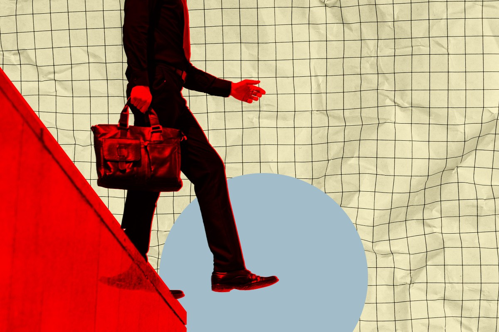

# 美国银行警告：投机已达极端水平，AI投资者该面对现实了

> 标普今年已涨 9%，创 2020 年以来最佳单季；但美国银行在研报中警告「投机正达到极端水平」，历史上这种估值跳升之后往往跟着「估值回弹」。更刺眼的是，美股的席勒市盈率已到 41 倍，而 1929 年黑色星期二那天只有 32.5 倍。

SpaceX 上市没几周就跌回 150 美元的发行价，成了这轮动荡最直观的注脚。

## 投机已达极端水平

科技公司正一片火热。尽管盈利平平，华尔街投资者仍在维系数万亿美元的估值。重仓 AI 的公司在这一点上尤其吃紧，因为它们动辄砸下巨额数据中心开支，却尚未——也可能永远不会——换来可观的利润。

这些公司的估值与其真实赚钱能力之间的缺口，正以极快的速度扩大，让分析师们心惊。据《财富》报道，标普 500 今年迄今已上涨惊人的 9%，并在上月底收出了 2020 年以来最好的一个季度。

但涨上去的终归要跌下来。美国银行在周二的一份报告里警告：「随着高估值股票出现明显的跳空上涨，投机正达到极端水平——这种情形在历史上往往预示着一次估值『回弹』。」

换句话说，华尔街可能得迎来一次难受的现实检验。

## 比大萧条前夜还贵

与此同时，专家警告美国经济的状况可能比上世纪 20 年代末大萧条爆发前还要糟。正如《每日电讯报》经济专栏作家 Russ Mould 指出的，美股的定价目前平均是其过去十年平均盈利的 41 倍，这个指标叫席勒市盈率（CAPE）。

把这个数字放在对比里看：将近 100 年前、现代史上最严重的金融灾难当天——黑色星期二，这个比率只有 32.5。

这番忧虑出现在一轮剧烈动荡之后。6 月底，一场大规模抛售重创标普 500，蒸发了数千亿美元市值。连马斯克的 SpaceX 也被卷进这轮下跌——这家公司几周前才刚刚上市，如今自身也背着沉重的 AI 开支，股价一路跌回 150 美元的发行价。

国际市场同样剧烈震荡，亚洲尤其明显，这或许预示着前方有麻烦的日子。

「在我们看来，这种波动证明了市场泡沫过多，也让人质疑这轮涨势能否持续。」资本经济（Capital Economics）的分析师对《财富》说。

## 分歧还在加大

动荡大概率会继续。但就目前而言，许多投资者依然和以往一样乐观。就在本周，SpaceX 还收获了摩根士丹利和高盛极为看多的评级，目标价分别为 300 美元——是这家航天公司当前股价的两倍——和 205 美元。

一边是「投机已达极端水平」的警告，一边是两倍于现价的目标价。谁对谁错，市场很快就会给出答案。

