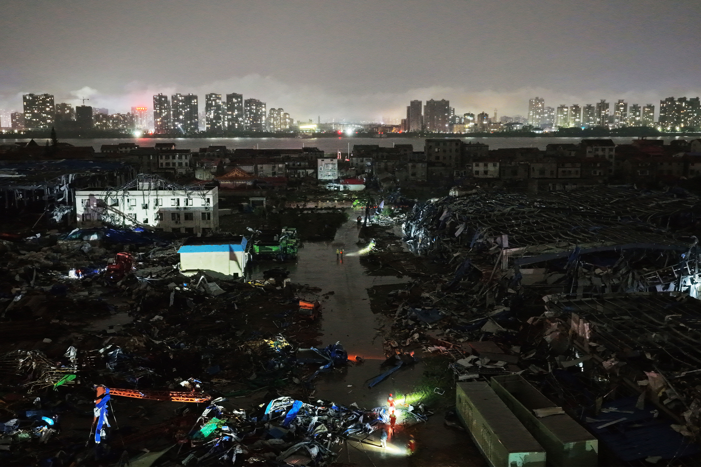

# 龙卷风把湖北男子从12楼公寓里卷走，他活了下来

> 周一深夜，强风暴袭击湖北黄冈，一名 30 岁男子被从 12 楼公寓里直接卷出窗外。他奇迹生还，目前仍在重症监护室。这场风暴已造成至少 11 人死亡、331 人受伤，4800 多所房屋受损。

他的柜子被从墙上扯下来，沙发被掀离地面，黄冈的重型卡车被抛出近百英尺。

## 发生在12楼

提到诡异龙卷风，多数人想到的是它在俄克拉何马州的拖车营地横冲直撞——而不是中国中部的高层公寓。

但周一深夜，湖北发生的事情正是如此。极强的风暴撕开黄冈市，把一名男子从 12 楼公寓里直接吸了出去。据 CNN 报道，这名 30 岁男子奇迹般生还，目前正在重症监护室接受治疗。

风力之大，据报把他的柜子从墙上扯了下来、沙发掀离地面，而黄冈各地的重型卡车被抛出近百英尺。这场猛烈狂风已造成至少 11 人死亡、331 人以上受伤。风暴还损毁了湖北 4800 多所房屋。

## 风速达到飓风级

据路透社报道，这场龙卷风的风速最高达到每小时 93 英里，按扩展蒲福风级相当于飓风级风力。

中国部分地区确实会遇到龙卷风，但研究显示，过去几十年严重的龙卷风活动已大幅减少。因此，这样的龙卷风在湖北极为罕见——据 CNN 报道，上一次有龙卷风落地还是在 2021 年 5 月。

造成这场龙卷风的天气系统源自超强台风「美莎克」：这个庞大的热带气旋于上周五登陆，在致命洪水中迫使数万人撤离。

