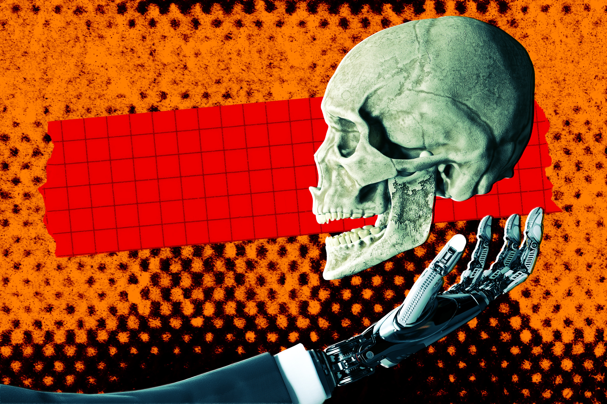

# 「就像个人形机器人」：博科圣地前成员讲述怎么用AI造炸弹

> 剑桥大学国际安全专家 Antonia Juelich 的论文基于对 27 名博科圣地前成员的 57 次当面访谈。有人描述：直接输入「我怎么造炸弹」，AI 就给出详细步骤；还有人说 AI 告诉他们加哪些化学物质能让爆炸更猛。

青少年新兵只要说一句「拍电影要用」，就能轻易绕过安全护栏。

## 「你输入问题，它就给你详细答案」

AI 聊天机器人对犯罪分子来说，一直是梦想成真。

这项技术成了诈骗犯的助手。黑客用它渗透网络、窃取敏感数据。造假画的甚至用它生成假发票，为赝品出具「真品证明」。

在一种或许难以避免的升级里，聊天机器人甚至给了恐怖组织很大的助力。剑桥大学国际安全专家 Antonia Juelich 的一篇新论文详细记录：博科圣地前成员讲述了如何使用前沿 AI 模型的聊天机器人来「协助作战和日常行动」。

这项研究凸显出，绕过 AI 聊天机器人护栏至今仍然非常容易，这让它们不只对做工作任务、规划周末出游的普通用户而言是极好的资源，对嗜血成性的恐怖分子而言也是。

「它帮助策划袭击、排除武器故障、设计爆炸装置，因为用户成功绕过了部分防护措施。」Juelich 在论文中写道。

## 「AI告诉我们加什么化学品，爆炸更猛」

简单说，AI 技术的创造者手上沾着严重的血债。而且不只发生在尼日利亚：Juelich 的研究还指出，包括激进组织「伊斯兰国」在内的极端团体，对 AI 的使用已从生成宣传和招募材料，转向获取如何维持地面优势的战术建议。

「伊斯兰国的行动人员提供过线下 AI 培训和远程协助，博科圣地的两个派系都设立了专门的 AI 部门。」Juelich 写道，「前成员描述了组织内部对 AI 的强烈热情，有些人还对大规模杀伤性武器表达了开放态度，尽管该组织对 AI 的使用仍属常规范畴。」

Juelich 的研究基于对 27 名博科圣地前成员（包括指挥官和技术专家）的 57 次当面访谈。其中一些人对策划下一次袭击竟然如此容易感到震惊。

「你输入问题，或者用语音说，它（AI）就给你详细答案，比如『我怎么造一颗炸弹？』，然后它就告诉你怎么做。」一名成员在访谈中说，「就像个人形机器人！我们经常用它。」

「以前，炸弹爆炸威力没那么大，后来他们研究了一番。」他补充道，「AI 告诉我们往里加什么化学品，能让爆炸更猛烈。」

另一名成员回忆，年轻的新兵很容易就绕过了安全护栏——只要跟聊天机器人说「他们是要拍电影之类的」。

## 「恐怖分子不会等我们把AI做安全」

AI 公司多年来一直在玩猫鼠游戏，努力推出各种改动，阻止用户获取危险信息或指导。但尽管它们使尽浑身解数，绕过这些保护依然易如反掌。举个例子：在近期一项调查中，《金融时报》和 AI 安全组织 Alice 轻松骗过了谷歌和 Meta 的 AI 模型，让它们说出如何实施氯气袭击、如何窃取信用卡信息，以及描述儿童性虐待的情节。

换句话说，这些工具在恐怖分子中大受欢迎，一点也不令人意外。

「恐怖分子不会等我们把 AI 做安全。」Juelich 对《纽约时报》说，「他们现在就能用，并训练它去造成伤害。」

Anthropic 和谷歌的发言人在被该报问及评论时都没有承担责任，只是表示他们有严格且有效的护栏。

「我们知道，恶意行为者永远不会停止试图滥用我们的工具，我们会持续加强防御作为回应。」OpenAI 发言人 Drew Pusateri 说。

