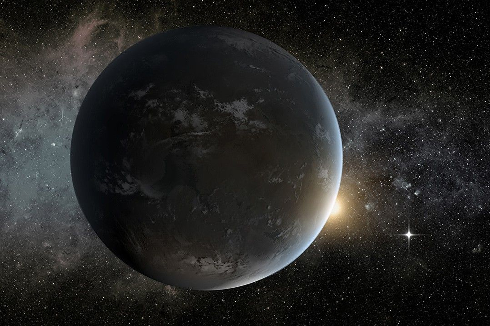

# 25光年外那颗「隔壁邻居」，质量只有地球两倍，就在宜居带里

> 加州大学欧文分校的研究者重新测量了红矮星系统中的 GJ 3378b，把它此前的质量估计从地球的至少 5 倍修正到大约 2 倍。这意味着它不一定是那种大气压得让人窒息的「超级地球」，而成了已知最近、最诱人的潜在宜居候选之一。

「把地球缩到一个苹果那么大，它的大气大概就相当于苹果皮那么厚。」

## 质量被高估了

最近发现的一颗系外行星离我们只有 25 光年，它和我们这颗行星的相似程度，比人们一度以为的要高得多。

这颗遥远的世界被命名为 GJ 3378b，运行在一颗红矮星的宜居带内——红矮星比我们的太阳小得多、也冷得多——那里的温度刚好允许液态水在表面存在。

但一开始，它可能存在生命的可能性看上去并不乐观。天文学家怀疑它是颗岩石行星，可它的质量至少是地球的五倍，也就是所谓「超级地球」。如此沉重的一颗世界，加上惊人的表面重力，会拥有一个把一切生命可能都压熄的大气层。

## 加州大学欧文分校的复核

但现在看来并非如此。在发表于《天体物理学杂志》的一项新研究中，加州大学欧文分校的研究者重新审视了这颗系外行星，发现它的质量其实要可控得多，大约是地球的两倍。再考虑到它与太阳系的距离，它一下子成了已知最近、最诱人的潜在宜居候选之一。

「这颗真的很让人兴奋。」论文第一作者、加州大学欧文分校天文学副教授 Paul Robertson 在关于这项工作的声明中说，「它是我们最近的宇宙邻居之一。25 光年听起来很远，但银河系的直径大约是 10 万光年，从这个角度说，它就是我们隔壁的邻居。」

在我们知道 GJ 3378b 到底有多宜居之前，还有更多侦查工作要做。最大的问号是它的大气层：它有没有大气？这层大气是否足够厚实、能抵挡母恒星的辐射？它又施加了多大的气压？

## 苹果皮一样厚的平衡

这是一个微妙的平衡。「如果你把地球缩到一个苹果那么大，」Robertson 解释道，「它的大气大约就相当于苹果皮那么厚。」他补充说，这个厚度正好足以支撑液态水和可呼吸的空气，同时还能提供对太空辐射的防护。

天文学界还有一场激烈争论：红矮星系统到底能不能住人。这类恒星被认为极不稳定，会定期爆发出强烈的耀斑。由于它们的宜居带更小，这个可能维持生命的区域就被拉得更靠近这些爆发，而爆发可能剥离行星的大气，把所有刚刚萌芽的生命消杀干净。

离恒星这么近，还意味着这类行星很可能被潮汐锁定——恒星的引力让它们无法自转，于是总有一面朝着恒星。

