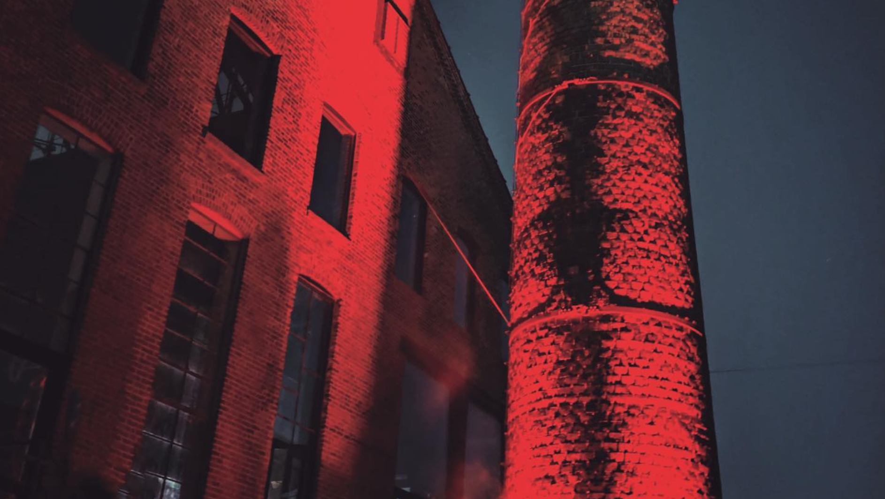

# 纽约最火夜店把智能眼镜拉黑了：带进来就永久封禁

> 纽约地下夜店 Basement 直接放话，智能眼镜就是移动偷拍设备，谁带进来——不管是戴着还是揣包里——当场请走，还可能永久拉黑。

纽约夜店 Basement 亮明态度：智能眼镜一律禁入。

纽约地下夜店 Basement 在圈内一直以苛刻、神神秘秘的入场标准出名，风格类似柏林那家传奇俱乐部 Berghain。你在门口保镖面前等一句"你行不行"，要么进到那片暗红色灯光笼罩的舞池，要么被贴上"不够酷"的标签劝退。这套玩法本身就是它的魅力。

但最新这条入场规矩，它可一点儿不藏着掖着。周四在社交媒体上，Basement 明明白白发了一条"智能眼镜政策"：任何戴着这种间谍设备的人，直接被赶出门。

"我们禁止拍照录像，是为了保护舞池里每个人的隐私、安全和自由，"公告开头这么说，"那些能隐蔽录像的设备，跟这条政策根本不兼容。"

它补了一句更狠的："任何人把智能眼镜带进场——无论戴着还是放包里——都会被请离，并可能永久封禁。"

你没听错，永久封禁。

酒吧常客们对这条公告挺买账。有人留言"BASEDment"（双关，既叫 Basement 又夸它"够硬核"），另一个说"每家俱乐部都该这么规定"。

当然要讲清楚，像 Basement 这种夜店，向来有一套主观又模糊的准入标准，真有人傻到戴着 Meta 眼镜去，本来大概率也进不去。可它觉得有必要把话挑明，恰恰说明智能眼镜现在有多招人烦、多掉价。Meta 砸了上千万美元做广告，连 Kylie Jenner、姆巴佩这种全球顶级流量都请来背书，也改变不了这件事——在很多人眼里，它们永远就是"变态眼镜"。

这件事和"新派夜店禁手机"还不太一样。手机我们认了，它就是生活的一部分，难得断一会儿挺好，至少不至于被发到陌生人的 Instagram Reels 上社死。但智能眼镜传递的信号是：你不受欢迎。

这些小监控设备被用来在当事人不知情的情况下录像，还让一群厌女分子靠偷拍骚扰女性来网上博眼球。没人信 Meta 会怎么处理那些录下来的画面和数据，但我们已经知道，它海外外包的审核员曾趁佩戴者不知情，盯着人家裸体和性生活看。说白了，这东西的"氛围"就是差。

眼镜当然还会继续泛滥，但像 Basement 这样的场所，正在守住自己的底线。
