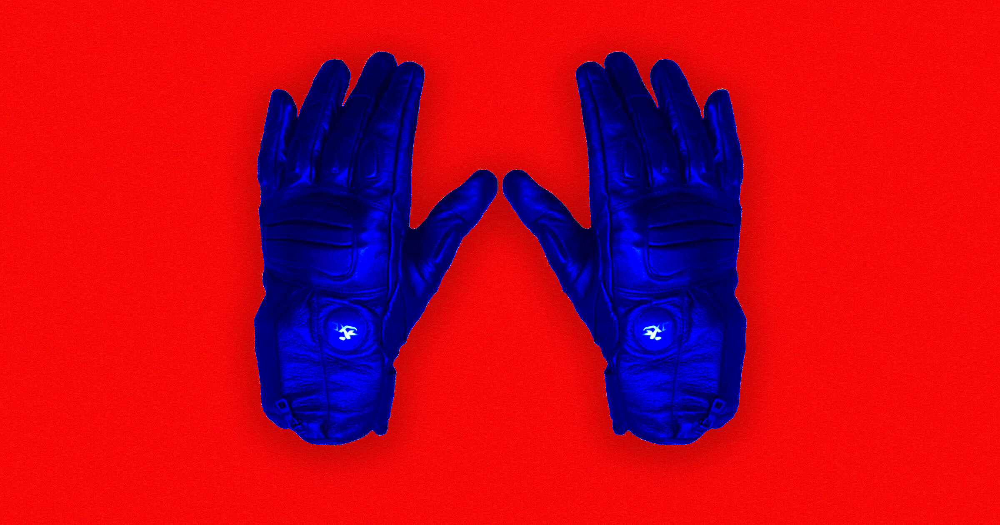

# 警察局长炫耀：我手下用电击手套电人，都两年了

> 俄克拉荷马州警察用电击手套制服两名学生引发公愤后，亚利桑那一个小镇的警察局长反而出来"炫耀"：我们用电手套电人，都两年了，效果很好。

电击手套（GLOVE）被用于执法，引发人权争议。

当俄克拉荷马州的警察承认，在 2025-2026 学年里用电击手套制服了两名学生，社区理所当然地愤怒了。这件事紧跟着《卫报》和 404 Media 的新报道——报道揭露美国移民与海关执法局（ICE）下了笔大单，采购自己的电击手套军火库，把这种粗暴的执法装备推到了全国聚光灯下。

尽管最近才"声名狼藉"，但"Generated Low Output Voltage Emitters"（低输出电发射器，简称 GLOVEs）绝非新事物。在右翼媒体 Daily Wire 最近一次采访里，亚利桑那州萨瓦里塔这个小镇的警察局长炫耀说，他手下用这玩意儿已经好多年了。

萨瓦里塔人口刚过 3.7 万，常备警力约 68 人。局长 John Noland 得意地说，这些警察电嫌疑人，前后大概有两年了。

"在亚利桑那，我们是第一家把这套装备投入街头巡逻的执法机构，"Noland 对 Daily Wire 说，"我们用得很成功。"

虽然联合国一位酷刑问题特别报告员已经宣布，这类装置"本质上残忍、不人道或有辱人格"，这位局长却不为所动。"这不算不人道，"Noland 断言。

"过去几年，我们的联邦特工、边境巡逻、ICE 探员，还有国土安全部其他人，都在现场跟人较劲，想让他们服从，现在没那么费劲了，"Noland 补充道。

维权律师指出，问题在于这种态度把每个公民都当成需要"服从"的刁民，完全无视手套会被过度亢奋的警察滥用——事实上，滥用已经在发生了。

2025 年，肯塔基一名男子被看守所人员用 GLOVE 电击 27 次，外加电击枪戳了 13 下，最终心脏骤停死亡。

萨瓦里塔自身就有不堪的警察暴力史，这座城市迟早也可能要为自己的 GLOVE 付出一条人命的代价。
