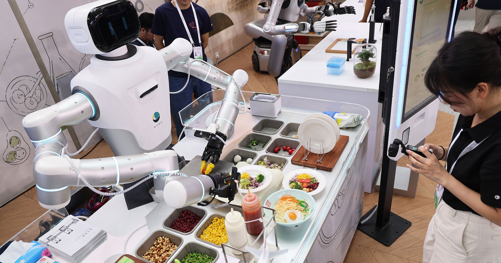

# 中国公司推出 AI 机器人厨师，北京这场大会把炒菜炒成了科技秀

> 在世界机器人大会上，中国企业亮出多款 AI 厨房机器人：能颠勺爆炒的炒菜机器人、带人形厨师的自动餐车，连北京西南郊都开出了全机器人拉面馆试运营。

中国公司展示 AI 机器人厨师。

中国工程师正盯上一个应用机器人领域最让人眼热的目标：全自动烹饪。

据《中国日报》报道，在热闹的北京世界机器人大会上，橡鹿机器人（Oak Deer Robotics）发布了三款推进厨房自动化的产品。它们有的独立成件、有的做成拟人形态，包括一个叫 CookingMuse 的"多模态烹饪 AI 模型"、一台集成 AI 的烹饪机器人装置，还有一台带小个子人形厨师的 Fully 自动餐车 RobotCook。

按《中国日报》说法，基础款烹饪机器人现场做了两次 Live 演示，炒了豆腐、以及猪肉炒青椒。根据公司官网，它的机器人专门做"中式炒菜"，靠一个能烧到 300 摄氏度的机械炒锅、一套食材投放系统，外加一套 AI"全自研翻炒算法"完成。

这家部分国有的橡鹿，据《中国企业家》杂志去年报道，其烹饪机器人已经铺到全国 300 多座城市、4000 多家门店。

另一家机器人公司海康机器人（Hikrobots）被路透社摄影记者拍到，在主展馆里摆了几台人形机器人，演示基础快餐店服务。DWS News 拍到的画面里，系着围裙的人形机器人小心翼翼地把各种食材放进一个桶里，再把桶放到出餐托盘上。

海康的机器人动作不快，但它们展示了人形机器人世界一种可能的未来。

在会场之外，据《环球时报》报道，一家叫"遇见未来"的机器人拉面馆在北京西南郊开始试运营。它被称为这座城市第一家全配置机器人拉面馆，提供三种面：蘑菇炸酱面、番茄牛腩、以及红烧牛肉面。

基本流程是：餐厅机器人先煮面、加汤、加肉和其他浇头，再由一条机械臂把成品转交给送餐机器人。每天大概仍需人工备料、上料，但真正的烹饪和上菜过程，几乎不需要人插手。

"我们想做的，是把机器的参数变成数字，用它来标准化每一碗面，"餐厅总经理李鹏振告诉《环球时报》。

虽说能搞定各色餐食的完全自动化机器人还远得很，但中国机器人大厨的飞速进展，显然让北京这片赛场热了起来。
