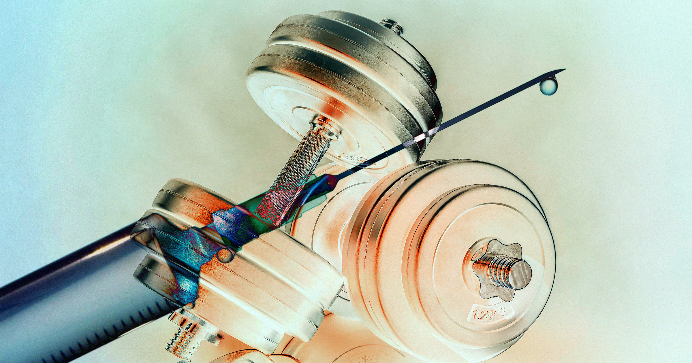

# 中国科学家研发可注射肌肉移植：不打针吃药，皮下一针"自己练"

> 中科院团队在小鼠身上做出会"自己收缩"的肌肉移植物，一针打进皮下就能持续分泌运动才有的有益因子。卧床病人、肌肉萎缩者，可能不用动就能"练"出肌肉。

可注射肌肉移植物在小鼠体内自发收缩。

在威廉·吉布森 1984 年那部定义赛博朋克类型的科幻小说《神经漫游者》里，构想了一个满是"乔伊小子"的未来——一群"几乎一模一样的年轻人"，胳膊和肩膀"因移植肌肉而鼓胀"。

在那部三部曲的世界里，这种移植是公司保镖间一种显眼的人体改造，用来增力、也用来唬人。

虽说目的不是让你不去健身房也能变大块头，但中国科学家说，他们已经把这个概念相当程度地变成了现实。据《南华早报》报道，研究者开发出一种"自己锻炼"的肌肉移植物，设计成可以注射到皮下。他们说，这能让卧床病人不下床就获得健身增益。这些"肌移植物"（myografts）对肌肉萎缩等病，以及其它与衰老相关的状况，也可能成为改变游戏规则的东西。

不过，从当下黑市上未经批准的 GLP-1 类药物的狂热来看，我们很容易想象某些健身老哥会抢着给自己注射这种肌肉移植物。（正如吉布森曾调侃的："街头总会找到东西的另类用途。"）

今天发表在《自然·衰老》上的一篇新论文详细描述了这些肌移植物——由皮下注射改造过的肌肉细胞得来——在小鼠体内"形成成熟、血管化的结构，并能持续自主收缩"。

"肌移植物改善了老年和肥胖小鼠模型中的全身肌肉量和功能，以及代谢和再生指标，"研究者写道。

虽然距离人体试验可能还有好几年，但科学家把他们这项涉及小鼠的临床前研究称为"朝这个方向值得注意的一步"。

这些移植物能给活动极度受限的人一条捷径。

"某种意义上，我们把运动中最好的那部分提炼出来了……避开了运动所有的负面效应，不管是对心脏的压力，还是对关节的压力，"中科院动物研究所教授、课题负责人 Ng Shyh-Chang 告诉《南华早报》。

"结果发现，最需要运动的人，往往也最动不了，"Ng 补充道，"所以我们需要某种方式来模仿运动，让他们先动起来，在真正能做需要的运动之前，先把基础健康搞上去。"

更妙的是，科学家发现肌移植物还能产生其它"治疗性蛋白"，即肌细胞因子（myokines），比如生长激素，甚至和减重相关的化合物如 GLP-1，能"抵消骨质或肌肉流失，且未见副作用"。

Ng 和团队没有选择移植叫类器官的整块三维结构，而是先注射细胞，让它们"在皮下慢慢长成类器官"。

一旦注入，细胞会自我组织成能自发收缩的肌移植物，模仿体育锻炼的效果。

"它 24 小时不间断地收缩，所以持续把有益的好因子分泌进血液，"Ng 告诉《南华早报》，"它分泌的好因子总量，超过你 acute（一次性）运动一小时能得到的。"

团队声称这些移植物的生长保持稳定，也就是说出现肿瘤样生长的风险较低——但只有当临床试验开展（Ng 正积极筹备），我们才能知道它对人类是否真的有效、乃至安全。专家告诉《自然》，走到那一步可能还要相当长时间，这套方法的可行性也还留着不少疑问。
