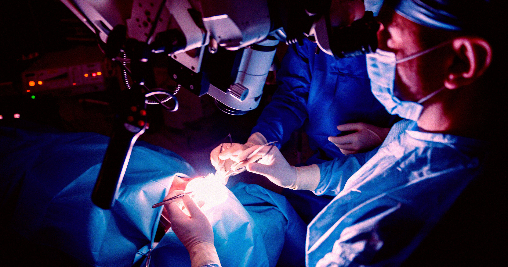

# 伦敦医生用AI"看清"脑部结构，成功切掉垂体瘤保住患者视力

> 伦敦一组神经外科医生在AI实时辅助下完成了一台垂体瘤切除手术——AI一边分析手术画面，一边标出隐藏的神经和血管，帮医生避开"差一毫米就可能失明"的危险区。

伦敦医生借助AI实时标记脑部神经与血管，完成垂体瘤切除手术

## AI如何"看"进脑袋里

今年5月，伦敦国家神经病学与神经外科医院的一台手术里，AI工具分析了手术的实时画面，在医生切除一名男子脑部垂体大肿瘤时，标出了神经、血管等关键结构，确保医生不会碰不该碰的地方。

这台手术保住了48岁患者Rhys Hibbert的视力。细节此前一直保密，直到现在才公开。Hibbert告诉《卫报》："我醒过来……能清楚看到房间里的每一样东西。"而在手术前，他不戴眼镜或不用拐杖根本走不了路。

## 垂体：差一毫米就出大事

垂体是脑中最娇嫩、最难动的部位之一，紧挨着给大脑供血的动脉和掌控视力的视神经。卫生官员对媒体说："差一毫米就可能造成关键差别"，轻则失明，重则中风甚至死亡。

肿瘤埋在脑底、视野之外，更是难上加难。医生得精准开一条路取走这个良性肿物，同时不能伤到脑本身。

## 看过成百上千台手术录像的"第二双眼睛"

这台AI由伦敦大学学院机器人与AI副教授Sophia Bano担任技术负责人，训练素材是数百段垂体瘤切除手术视频。训练时，研究者手动在每段视频里勾出血管和神经，让AI准确学会它们的位置。

Bano对《卫报》说，这套系统"见识过的手术案例之广，一个外科医生要花很多年才能遇到"。整个过程中人类医生始终掌控全局，AI扮演的是关键向导：它用从鼻腔植入颅底的摄像头实时追踪医生的手术器械，预判隐藏血管和神经最可能在哪，并高亮出可以取瘤的安全区域。BBC把它比作"给隐藏解剖结构做人脸识别"。

Hibbert对BBC说："从病人安全的角度，我绝对看得到好处。我们脑袋里可没有路标。"

## 技术没错，依赖才危险

这是一项了不起的成就，但也引出令人不安的问题：万一技术出错怎么办？随着越来越多医生靠AI写病历、查症状，AI进入医疗领域始终是敏感话题。

BBC指出，像垂体瘤切除这类手术，外科医生通常要在术前研究脑部扫描，把每位病人独特的解剖结构摸得门儿清。专家担心，医生可能对AI工具产生过度依赖，尤其是从小就用AI的新生代医学生。

Hibbert态度很明确："它把我的生活还给了我。"
