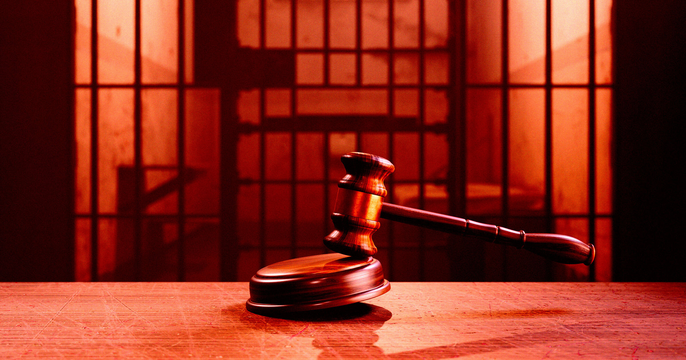

# 如果公司是"人"，那犯了大罪的公司该判死刑吗

> 130多年前，美国法律把"公司"当成了"人"，让它享受宪法平等保护。既然许多州里真人对重罪能被判死刑，那犯下滔天罪行的公司——理论上——能不能也判它"死刑"？

公司人格原则让科技巨头得以规避监管

## 一个延续130年的古老原则

130多年前，南太平洋铁路公司（Southern Pacific Railroad）在起诉加州圣克拉拉的官司里赢下了一场对私营市场的重大胜利。这桩案子实质上确立了：宪法第十四修正案的平等保护条款，对公司和对人一样适用，为"公司人格"（corporate personhood）这一法律概念铺了路。

如今美国和全世界仍被这个过时原则统治，它让强大的科技公司以"公民享有的同等保护"为由，公然藐视基本政府监管——体现在公司挖取消费者隐私数据、拒绝给员工医保、对抗公共卫生倡议，当然还有在选举里施加巨大影响。

果然，涉及私营公司的最高法院案子，结果几乎总是偏向有钱的一方。可如果公司是"人"——而美国许多州里，真人仍可能被判死刑——那我们是不是至少在法理上，能把犯下恶行的公司也送上"死刑"？

## 司法解散：公司的"死刑"早就有

理论上可以。正如Salon观察到的，"公司死刑"的正式说法叫"司法解散"（judicial dissolution），历史几乎和公司人格一样长。

早在1887年，17家大型炼糖厂就密谋合并成一家托拉斯，实质造出全球最大糖业垄断，史称北河炼糖公司（North River Sugar Refining Corporation）。这个卡特尔仅两年后就被纽约最高法院强制清算，理由是它滥用了公司特许状——集中权力、操纵价格。

这虽是个很具体的案子，却为美国反垄断法立下奠基性先例，显示了单个州理论上能动用的、保护公民免受公司之害的力量。

正如主审法官当时所言（据Salon）："公司的寿命，确实比最卑微的公民还要短。"

## 此后这类判决几乎绝迹

自那以后，动用"公司死刑"的判决少得可怜。2012年一篇关于司法解散使用的研究发现："2001至2010年间，没有一家上市公司因定罪而倒闭。"

然而，如果要说有什么时候该重启"公司死刑"，那就是现在：科技公司正碾平城镇，随意倾倒数据中心；AI公司收集的个人数据足以媲美NSA；Facebook这类社交平台甚至字面上在助长种族灭绝。

虽然极度保守的美国最高法院短期内不可能采纳这个思路，但事实就是：他们本可以——只要多一点司法之外的压力。
