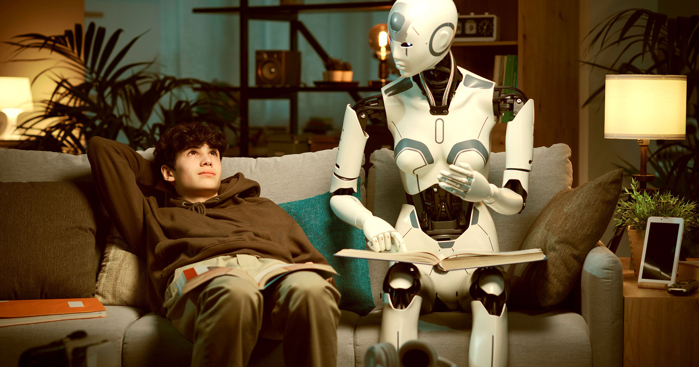

# 常出差的妈妈用AI克隆自己，陪15岁儿子聊天解闷

> 痴迷AI的爸妈们正用它来育儿，方式诡异得足以唤起你内心的卢德分子。一位常出差的认知神经科学家，给自己15岁的儿子造了个"AI版妈妈"陪聊。

一位妈妈用AI克隆自己陪出差的儿子聊天

## "我自己的道理被我反向利用了"

据Business Insider的一篇新报道，认知神经科学家Sarah Baldeo过去一年常因工作需要出差。她想在孩子不在身边时依然"在场"，于是给自己造了个定制的AI克隆。

Baldeo说，她把和儿子的聊天截图、以及写有自家价值观和家庭规矩的文档都上传给聊天机器人，让它学自己的性格。她鼓励儿子向AI请教——儿子也照做了。

作为青春期少年，儿子用得相当有创意。他问过AI一个问题：怎么说服 flesh-and-blood（真人）妈妈让他去芝加哥一家咖啡店玩。AI吐出了一套我们早已习惯的陈词滥调式说辞（"你妈妈非常看重新体验"，开头就来了这么一句）。

"我事后本能反应是：天哪，我被自己的道理操纵了，"Baldeo对BI说，"我反思了一下，觉得这用法挺聪明，因为我本来不是这么设计的。"

## 科技大佬带头"AI带娃"

从AI走俏主流，爸妈们就在拿它让生活轻松点，而现在这股势头比之前更猛。

最积极的倡导者里不乏科技圈领袖。OpenAI CEO Sam Altman最近建议，爸妈可以把家庭日历连上ChatGPT，让AI生成播客，在孩子上学路上聊他们的日常和兴趣。他此前还说过，无法想象"没有ChatGPT该怎么带新生儿"，坦承自己重度依赖AI当爹。

AI公司也在盯这块缺口。BI采访了一对夫妻，他们对一款叫Omi的AI穿戴设备感兴趣，它能持续监听你的日常生活（丈夫在推，妻子怀疑）。据BI，它有个叫"家长耳语者"（Parent Whisperer）的定制功能，会记录并总结父母和孩子的对话，还能靠听语气，在孩子可能情绪低落时提醒父母。

Meta则在开发一款叫"StoryKit"的AI应用，能自动生成并朗读给孩子听的个性化睡前故事。网上早就有一堆服务，让爸妈把娃塞进AI生成的故事里。

## 妈妈们其实在"借AI对抗不确定"

妈妈社交应用Peanut也注意到了这股趋势。其总裁Michelle Battersby说，团队发现妈妈们会在社区里问其他成员：你同不同意AI给的育儿建议？而不是只信AI。她们的应对有点反直觉：Peanut加了个AI工具，去社区里搜答案，再喂回给那位不确定的家长。

"我们没看到妈妈们用AI是为了把育儿变高效，"她对BI说，"我们看到她们找AI，是为了帮自己穿越不确定。"

当然，也许这些父母该担心的，是长期高频和AI聊天、依赖AI，对亲子双方认知和社交的深远影响。
