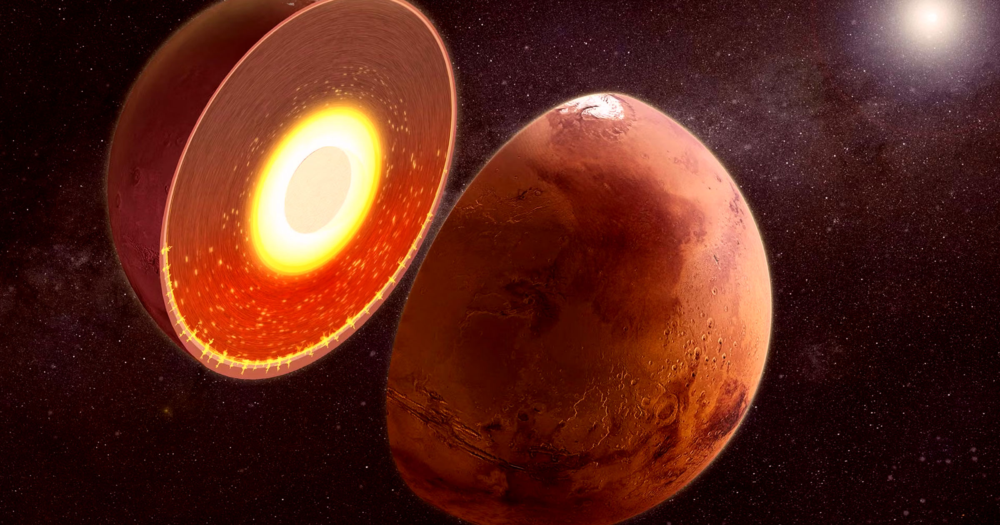

# 火星地下出现诡异"热不对称"，南半球比北边热400到750度

> 科学家在火星南半球地下深处探测到一处异常的"热不对称"——南半球的内部比北边热了约400到750华氏度。他们才刚开始猜测这到底意味着什么。

火星南半球地下探测到异常热不对称

## 温差大得离谱

正如《自然》（Nature）新论文所述，团队发现这颗红色星球南半球的内部，比北半球的内部大约热400到750华氏度（约220到420摄氏度）。这个出乎意料的温差，可能给科学家提供重要线索，指向数十亿年前这颗行星还温暖到能孕育生命的那段时期。

火星两半的地表天差地别：南半球密布陨石坑，地势高出好几英里；北边相对平滑，点缀着平原。

## "我们总假设行星内部是球对称的，其实未必"

"科学家通常假设行星体内部大体是球对称的，但事实未必如此，"论文第一作者、亚利桑那大学行星科学家Alexander Berne在声明中说，"随着我们拿到更多引力数据，就能确定行星内部三维结构的精微之处。"

"这些推断反过来成了我们设计未来任务、探索这些世界的蓝图，"他补充，"理解行星体内部结构，帮我们解开塑造它们形成与演化的那些过程。"

这处可观的"热异常"可能意味着：火星南半球的地幔，曾被一股足以引发火星特有变化的磁场覆盖。

## 它可能也影响了水的去向

"它也可能影响了火星的水文，包括那些可能曾蓄水的盆地的形成，"论文合著者、加州理工博士后学者Amirhossein Bagheri在声明中解释。

科学家才刚开始梳理可能的解释。一种假说认为，一次巨大撞击迫使热量从北半球逸出；另有随机对流、以及南半球巨大山脉困住多余热量的说法。

"这种温度差异，可能反映了区域性地幔对流，或是被火星厚重的南半球高地地壳保温了数十亿年，"科学家在论文中总结。

## 更大的谜题一角

这是一幅远未完成、需要很多年才能解开的更大拼图的一角。

"还有很多问题没回答，"圣路易斯华盛顿大学行星科学家Paul Byrne对《科学美国人》说。比如他质疑：为什么火星最大的火山省坐落在南北交界处、而非地幔热得多的南半球。

它的起源"在火星科学里仍是个悬而未决、而且相当根本的问题，"论文合著者、布朗大学行星科学家Nick Wagner对404 Media说，"这项研究没给出答案，但为搞清楚火星底下到底发生了什么，又添了一条证据线。"
