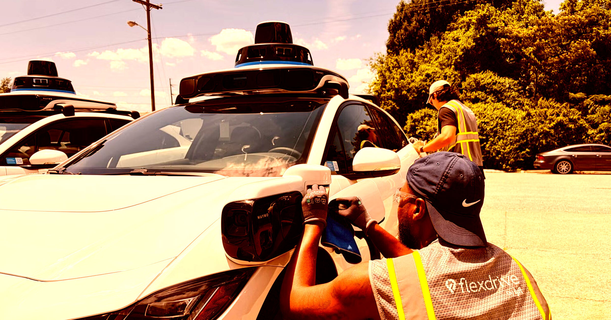

# 被无人驾驶抢了饭碗的前Lyft司机，如今在给Waymo机器人洗车充电

> 当无人驾驶出租车开始抢Uber和Lyft司机的活儿，这些司机去哪了？一篇Business Insider的调查给出答案：有些人转头去给淘汰自己的机器人出租车公司打工了。

前Lyft司机如今在Waymo保养场给机器人出租车洗车充电

## 车会自己开，但不会自己洗澡

自动驾驶车虽能自己跑，却没法自给自足。总得有人每天清洁、保养，确保它顺畅运行。Waymo作为领先的机器人出租车公司，在全美设有保养场（depots）干这类活儿，而不少员工自己以前就是网约车司机。

BI采访的纳什维尔保养场由Lyft运营，里面的员工似乎还挺喜欢新工作——不过采访是Lyft安排的，样本未必客观。

Chauncy Thompson说，他强烈偏好当机器人出租车的"车队运营助理"，而不是开Lyft，首先就是工时稳定。他的工作包括逐车检查、充电、清洁、测胎压——正是他当年开车时对自家车的那份细致。

"我想让车在路上好看，上路前轮胎状态完美，"他对BI说。

## "比开Lyft强多了"

Jonathan Baines开了十多年Lyft，他喜欢"在尖端事物上干活"的感觉。

"新鲜、有创新，"他对媒体说，"这能给我AV行业、Lyft和Flexdrive里本来没机会的发展空间。"

"我怀念开车，我爱跟人打交道。但论活儿本身，我更爱这个。"

Waymo和Lyft十月将在纳什维尔再开一个保养场，其中一半员工会是前网约车司机。活儿虽基础，却给被替代的工人一条新路。

## 岗位少得可怜

但机会实在稀缺。据BI，这座8万平方英尺、Waymo目前最大的设施，只雇约70名全职。不算少，可只要想想：一台机器人出租车不用休息、全天候运转，能干好几个人类司机的活——对比之下，机器人创造的岗位远少于它取代的。

人力资源管理协会（SHRM）首席知识官Alexander Alonso说，从开车转向保养机器人出租车，体现了看待AI与就业更有用的角度："工作的重新设计"（redesign of work）。

"大指标不光是丢了多少岗位，"Alonso对BI说，"而是：岗位在怎么变？"

SHRM的研究显示这种"再技能化"已在发生：当前招聘里35%的技能，在一年半前的同类岗位里根本不存在。

耐人寻味的是，Waymo不愿透露它为多少台（超过3500台）机器人出租车配备了保养人力。
