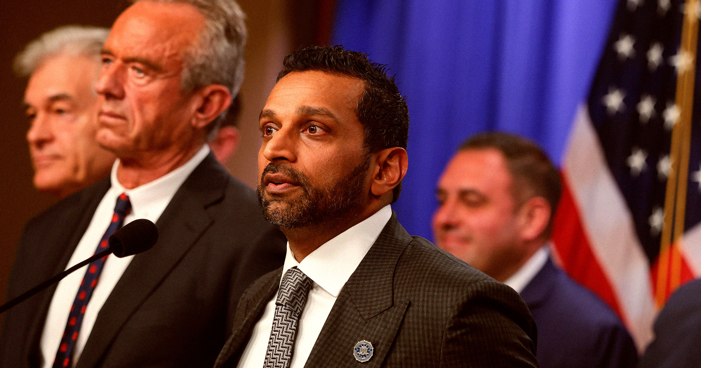

# FBI被曝放宽招募标准：曾有兽交史也可入职，前提是未成年时发生

> CBS曝FBI今夏悄然降低背调门槛：嫖娼不超3次可过，兽交/虐待动物若发生在18岁前也可考虑；官方辩称仅限“幼年被虐待”等极窄情形，前探员痛批此举暴露招募困境与用人风险。

FBI放宽招募标准引争议

## 门槛悄然降低

在局长卡什·帕特尔（Kash Patel）治下，FBI的争议已一箩筐：被指酗酒、被曝采购民众位置数据、热衷阴谋论——而他本人上任前几乎没有相关履历。如今，招人标准也被曝大幅放水。

据CBS News援引内部人士，FBI今年夏天悄悄修改了联邦探员及其他岗位的背景审查标准：嫖娼不再一票否决，只要不超过3次即可考虑；更令人咋舌的是，有兽交或虐待动物史的候选人，也可能被纳入考量，前提是行为发生在18岁之前。

消息人士还称，标准并未区分“被迫与动物发生性行为”与“自愿为之”。对此，FBI发言人辩称，相关放宽仅限“极窄情形，例如当事人幼年时被以动物实施性虐待”的受害者情况。

## 前探员：这预示用人风险

多名前探员与现职人员对此强烈反对。前FBI探员James Davidson直言：“兽交显然可能是更严重情绪问题的信号，即便不是，候选池也该足够大，绝不该取消这类排除条款。”

在新规前，FBI官网对特别探员的自动淘汰项写得很清楚：参与“嫖娼或兽交”即出局。如今改口，被内部人士形容为“招募出现了大问题”，可能让“背景可疑者”混入队伍，侵蚀机构公信力。

## 为何要放水？

帕特尔虽未直接回应此次调整，但此前多次呼吁放宽录用标准。他在7月接受前探员John Nantz采访时称：“我们因陈旧的苛刻要求，流失了太多合格候选人。”

外媒ProPublica去年11月还披露，其私人助理测谎未过却靠豁免入职，FBI随后否认。不管动机是“扩招”还是“安插亲信”，在外界看来，一个本就因领导人争议而形象受损的机构，再把“人品底线”往后挪，无疑是火上浇油。

底线一旦后移，就很难再移回来。

