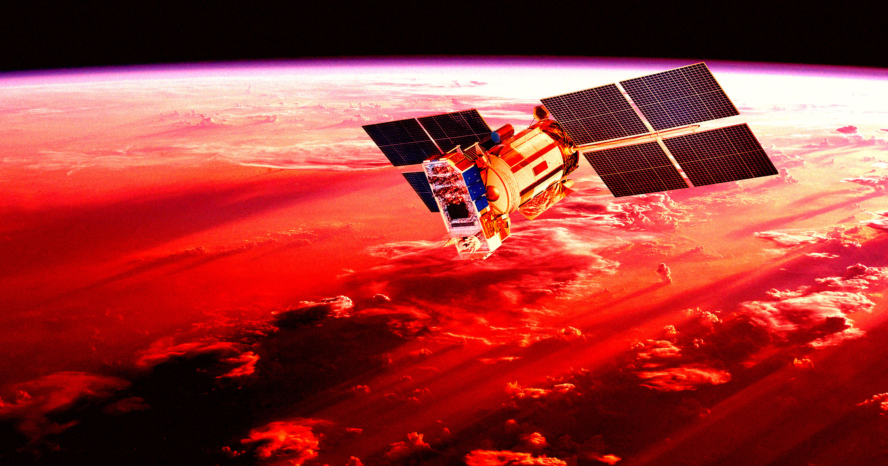

# GPS太阳风暴让定位偏差10米，自动驾驶险些集体跑偏

> 2024年11月一场20年来最强的太阳风暴让美国全境GPS定位偏移超10米，论文警告：要是赶上农忙季，精准农业和自动驾驶都得瘫。

太阳风暴期间GPS定位出现显著偏差，自动驾驶与精准农业面临风险

## 20年一遇的太阳风暴，把GPS晃偏了

去年11月，科学家发出“严重”太阳风暴预警——这是20多年来最强的一次。太阳甩出一大波带电粒子撞向地球磁层，极光绚烂的同时，通信卫星和无线电信号也跟着遭殃，连一枚飞往火星的NASA探测器发射都被迫推迟。

更直接的冲击在地面。一项发表于《地球物理研究快报》的研究发现，这场超级风暴让美国本土的全球导航卫星系统出现了超过10米（33英尺）的定位误差，持续数小时。研究团队直言，这个量级的偏差“足以扰乱精准农业和自动驾驶运输行业”。

论文写道：“结果凸显了准确理解各类空间天气现象的重要性，唯有通过协同观测与基于物理的建模提升预测能力，才能在空间天气事件中减少对射频应用的干扰。”

## 极光南移，一条“密度梯度带”扰乱信号

研究人员调集了分布全美的多种科学仪器，复盘了那几天的混乱。原本环绕地磁北极的极光卵带被硬生生推向赤道方向，上层大气中形成了一条“水平延展的高密度梯度带”，信号穿过这层大气所需的时间出现剧烈波动。

结果就是“中纬度地区显著的定位误差”。而且研究还发现，极光越亮，这种不规则性越强，GPS精度掉得越厉害。

## 错开农时算幸运，下一次未必

好在这次风暴发生在农忙结束后，装有GPS的拖拉机大多已入库，否则后果不堪设想。作为对照，2024年5月的另一场超级风暴据估算给美国农业造成了约5亿美元损失。

论文警告：“如果11月的超级风暴发生在美国农业季节，可能会给美国农业带来重大经济损失，同时也会影响自动驾驶运输行业。”

当自动驾驶汽车、农业机械越来越依赖厘米级定位，头顶的太阳活动就不再只是天文爱好者的谈资——一次太阳打嗝，就可能让地面的机器集体“走神”10米。
