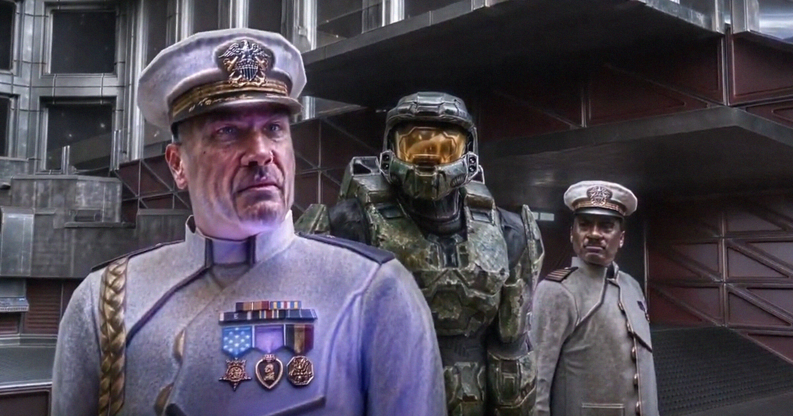

# Nvidia AI“美化”游戏泄露，效果比想象更恐怖：帧率腰斩、审美翻车

> DLSS 5未发布版本被泄露后遭玩家实测“灾难化”：光追变“渣追”、帧率从90跌至29、经典角色被“网红化”，连黄仁勋也从“图形的GPT时刻”改口称讨厌AI渣内容。

Nvidia DLSS 5 AI美化效果遭吐槽

## 从“光追”到“渣追”

Nvidia年初发布DLSS 5时，卖点是用AI重做游戏画面。官方Demo就透着一股浓浓的AI味——违和、割裂、塑料感。玩家直接给它起了个外号：“slop tracing”（渣追），讽刺它把光线追踪做成了“AI泔水”。

这波口碑差到连CEO黄仁勋都被迫下场辩护。但更糟的还在后面：一个未完成的DLSS 5版本被意外泄露，MOD玩家第一时间拿去实测，结果比官方Demo更惊悚。

## 泄露版实测：童年滤镜碎一地

一段病毒视频里，有人用泄露版跑《光环：战斗进化》（2001）的过场动画。效果不像“重制”，更像被丢进十几轮压缩做成的“深炸梗图”：色彩斑驳、廉价HDR感、人物面部被强行“超写实”，童年记忆直接被AI“精修”到认不出。

测试者评价：“即便在最理想的设置下，它也会抹掉原作的一切，让画面变得极其平庸。”

更致命的是性能。有玩家在《最终幻想7：重生》（2024）上测试，帧率直接腰斩；另一位在《GTA5》上从90帧跌到29帧。所谓“美化”，代价是流畅度崩盘。

最出圈的是一张对比图：经典角色克劳德·斯特莱夫被AI“ yassified”（网红化）——像是化了浓妆的Cosplay，精致却完全丢了原作气质。

## 黄仁勋也改口了

需要强调，这并非正式版，不少案例是把参数拉到极限的极端效果。但它暴露的核心问题很清晰：AI重绘极易踩碎原作美术风格，用一种廉价、艳丽的“AI审美”覆盖掉原本的氛围。

讽刺的是，今年3月黄仁勋还称DLSS是“图形学的GPT时刻”，口碑崩后则改口称自己也讨厌“AI泔水”，坚称DLSS 5“不一样”。玩家并不买账——当“AI味”成了减分项，再强的算力也救不了审美翻车。

