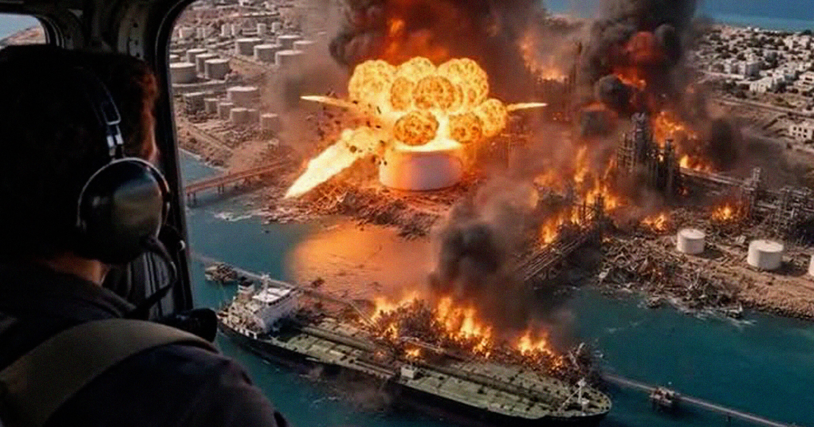

# 特朗普转发AI伪造伊朗袭击视频，美军陷入混乱

> 特朗普在 Truth Social 连发两条 AI 生成的“美军轰炸伊朗 Kharg 岛”视频，配文“炸成碎片！！！”，迫使美方官员紧急澄清“袭击并未发生”——副总统万斯只能解释为“总统喜欢在社交媒体上换换花样”。

特朗普转发的 AI 伪造伊朗 Kharg 岛遇袭视频引发混乱

## 两条 AI 视频，一次官方辟谣

据《独立报》报道，特朗普在周日夜间连发两条看似从直升机视角拍摄的爆炸视频，画面里 Kharg 岛火光冲天。他只配了一句：“Kharg 岛被炸成碎片！！！”全程未说明系 AI 生成。

周一，美方官员被迫澄清：视频中的“袭击”并未发生，Kharg 岛——伊朗石油出口枢纽——一切如常。两条视频间隔仅一分钟，像是刷上瘾后的连发。

被记者追问时，副总统 JD·万斯的回应显得苍白：“你知道的，总统喜欢在社交媒体上换换花样，”他补充说，特朗普是在“向伊朗人传递信息”。

## 真假交织的时间点

AI 视频的时间点极具误导性：就在那个周日夜里，美军确实对伊朗的 Larak 岛发动了一轮打击，结束了约一个月的直接攻击间歇；伊朗随后向约旦境内的两处美军基地发射导弹。

次日一早，特朗普再发一帖称伊朗是“失败国家”：“它完了！没有海军，没有空军，没有货币。”随后补上一句：“他们唯一有的，就是来自美国的假新闻。”——在刚发完 AI 假视频后指责别人造假，讽刺直接拉满。

伊朗国家石油公司负责人 Hamid Bovard 周一批驳称总统的帖子“可笑”，并称 Kharg 岛“平静且正常”。

## 用 AI 幻觉打一场顺风仗

这不是偶发。过去几年，特朗普频繁发布 AI 生成的嘲讽对手、神化自己的图像，如今这套“AI 段子”正渗入对伊战争叙事。这场战争已致数千平民死亡、搅动全球经济，本应数周结束却拖向半年；美国未能有效保护地区盟友免受伊朗导弹无人机报复，也未能如宣称那般控制霍尔木兹海峡——尽管特朗普说伊朗“没有海军”。

为何要直面这些？直接用 AI 造一场看起来打得很顺的仗更省事。白宫几天前还第无数次宣称“美国控制着霍尔木兹海峡”。当谎言不够用，AI 幻觉就成了新的战报。
