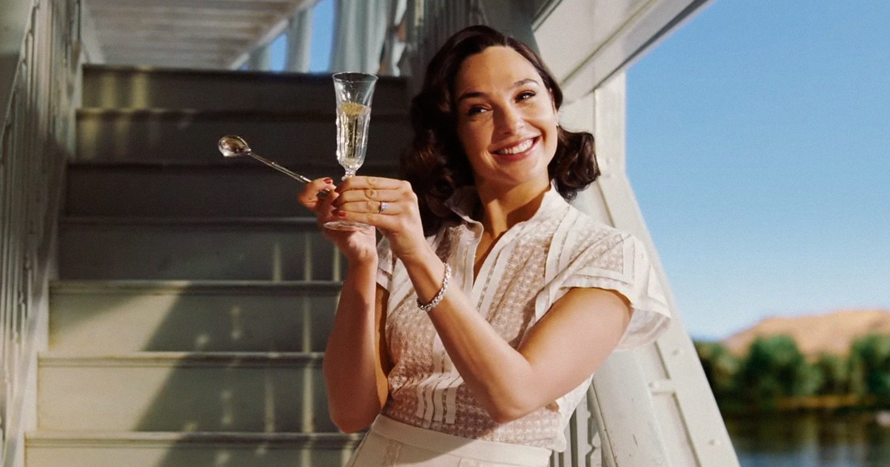

# 盖尔·加朵主演重度AI生成比特币赞歌电影，辩称不上车就出局遭群嘲

> 道格·里曼新片《Bitcoin》被曝大量用AI“调整”表演、演员需在无标记动捕棚演出，盖尔·加朵称“火车已离站，不上车就出局”并强调已让律师审半年AI条款，却被网友批“只保自己不管同行”。

盖尔·加朵回应AI电影争议

## 又一次站错边？

捕捉时代情绪向来不是盖尔·加朵的强项。从2020年3月那段合唱《Imagine》的病毒视频，到多部作品里被群嘲的台词演绎，这位凭《神奇女侠》两度出圈的以色列演员，近年更像是“梗”的制造机。

如今好莱坞最撕裂的话题正是AI是否该进入创作核心，而加朵又一次踩进了舆论漩涡。据Variety报道，她将在导演道格·里曼（Doug Liman）的新片《Bitcoin》中出演，该片由凯西·阿弗莱克、皮特·戴维森主演，讲述比特币相关故事。争议点在于：片方今年在英国选角时披露，影片可能用AI“调整”表演，演员需在“无标记表演捕捉舞台”上演出，而非实景拍摄，且需接受“新AI技术”。

## “火车已离站，不上车就出局”

在播客“Happy Sad Confused”中，加朵为参演辩护：

> “我害怕AI，但难道就因为害怕就扭头不看吗？不会。我害怕，但我也在摆弄它、学习它、逼自己去懂。火车已经离站了。”

> “你要么跟它一起工作，要么就彻底出局。”

她同时强调，自己和律师花了“六个月”逐条审查“能想到的所有AI场景”，以确保AI“绝对不会动我的表演”。换言之，她把自己的肖像和表演保护了起来。

## 网友：只保自己，不管同行？

这番“精致利己”的辩护并未平息怒火，反而点燃更多嘲讽：

- “盖尔·加朵总有本事永远站不对边，现在又来为电影里的AI辩护。”
- “说实话，看过她的表演后，如果AI要动什么，就该先把她的表演给修了。”
- “所以她的意思是：保住自己的饭碗就行，其他因AI失业的创作者无所谓？懂了。”

类似“不用AI就会被淘汰”的叙事，近两年在圈内被反复灌输——科技公司一边强推AI，一边让从业者产生“不上车即掉队”的焦虑。但随着观众对AI的抵触越来越强，甚至有品牌开始以“我们没用AI”作为卖点，这套说辞正快速失灵。

对加朵而言，这部“AI+加密”双重敏感题材的传记惊悚片，很可能又会成为一次大型“尴尬现场”——上一次是合唱，这一次是站队。

