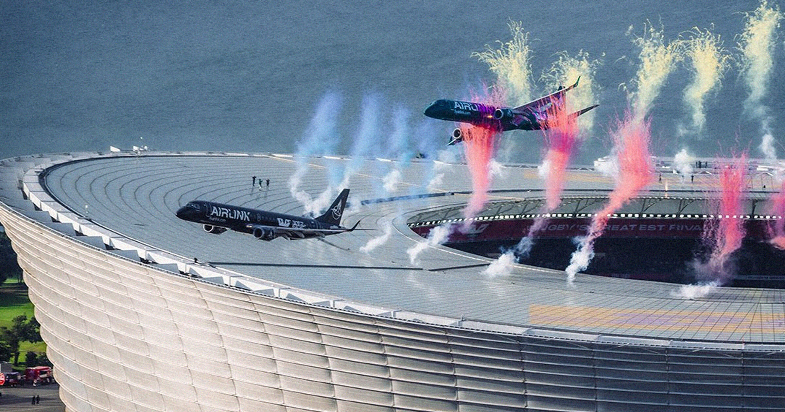

# 航司为两架客机贴顶飞越爆满体育场辩护，专家称别开先例

> 南非Airlink两架ERJ客机超低空掠过5.5万人体育场屋顶，最近处不足15米引众怒；航司称获民航局批准、机组均为资深机长，但专家警告乱流或鸟击即成灾难，且会给行业立下危险标杆。

两架客机超低空掠过体育场

## 贴顶掠过，像是“差点坠毁”

南非航司Airlink近日为一场特技飞越辩护：两架Embraer支线客机在开普敦一座5.5万人体育场上空超低空通场，距屋顶仅数米之遥。

多角度视频在社交媒体疯传，画面里客机几乎擦着屋顶掠过，现场正举办南非对阵新西兰的橄榄球赛。不少观众第一反应不是“精准操控”，而是“这差点就撞了”。

## 航司：我们很专业，也获批了

面对舆论反弹，获卡塔尔航空参股的Airlink回应称飞越“经过极其周密的规划，尽可能安全”：

> “Airlink注意到相关担忧。”

> “两架飞机均由经验极其丰富的机组执飞，每组配备三名资深机长，分别担任机长、副驾驶和安全/技术官。”

航司强调，低空低速通场“需要精心规划与排练”，且已获南非民航局（SACAA）和空管部门批准。

## 专家：再专业也别拿客机玩特技

航空界并不买账。Flightradar24测算，其中一架飞机距屋顶不足50英尺（约15米）；且两机高度明显不一致，削弱了“严密控制”的说法。

职业飞行员、作家Scott Bateman在X上写道：“世界各地数百名专业飞行员看了影像都表示担忧。即便规划再周密，成熟的安全文化也该承认——这次的余量比必要的更紧。”

澳大利亚航空顾问Keith Tonkin更直接：Embraer这类支线客机本就不是为这种超低空设计的。他对美联社警告：“更大的问题是标杆被立起来了——别人会觉得自己也能来一次，而这不会有好结果。”突发的乱流或一次鸟击，都可能酿成灾难。

获批不等于合理，专业也不等于可以把载客飞机当航展道具。当5.5万人在看台上，50英尺的余量，容不下任何意外。

