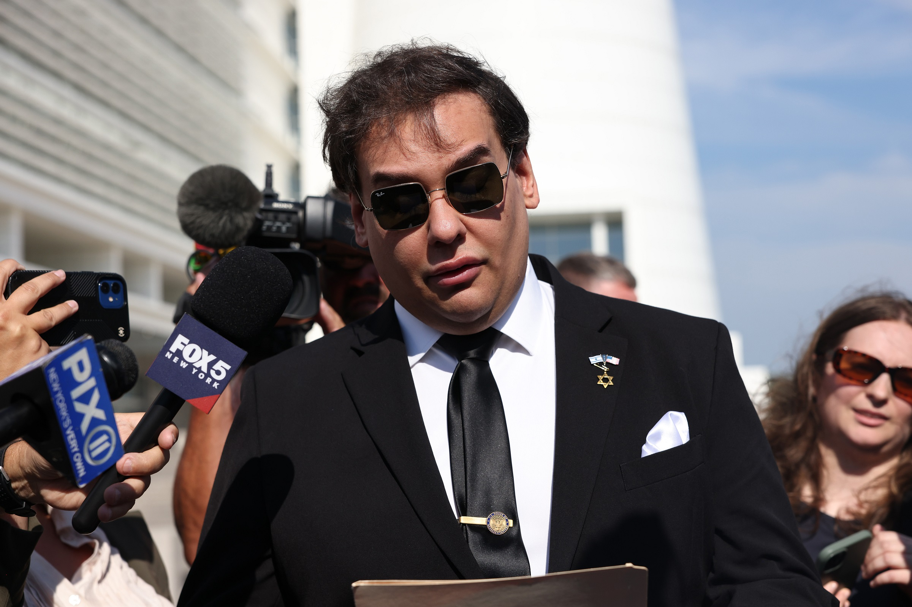

# Kalshi开出史上首张终身禁令，竟给最搞笑的人

> 预测市场 Kalshi 开出史上首张终身禁令，对象是共和党前众议员、梗王 George Santos——他一边下注自己会否出席特朗普国情咨文，一边发真假难辨的动态操纵盘面，赚了近1.8万美元，最终被罚7万多美元并移送联邦监管。

预测市场 Kalshi 对 George Santos 开出史上首张终身禁令

## 一边下注一边导演行情

据《纽约时报》报道，Kalshi 合规部门认定，今年2月特朗普国情咨文前后，Santos 在相关“是否出席”的 Yes/No 合约上下了多笔注。作为能直接影响结果的当事人，他本被禁止交易该市场。

更离谱的是，他随后公开喊话影响价格——其中部分表态“虚假或误导”。咨文前几天，他在 X 上发视频说：“我会在国情咨文现场的旁听席，兄弟们”，没过多久又发帖称自己被困在机场，只能在电视上看，并补了一句“FML”。

这一套自导自演成功拉动了合约价格，Santos 从中获利近1.8万美元。对一个以做梗为生的政客来说，连操纵都带着表演性质。

## 罚单比获利多四倍

Kalshi 给出重罚：罚款71356美元，并把交易记录通报给商品期货交易委员会（CFTC）。联邦机构在7月与 Santos 达成和解，要求吐回全部获利，另处17500美元罚款。平台同时宣布终身禁入——这是 Kalshi 有史以来第一张终身禁令，放在一个被怀疑内幕交易频发的市场里，讽刺意味拉满。

BLOCKQUOTE:Hey @Kalshi thanks for the lifetime ban from your gambling platform. Let's see how much longer you guys are around for.—— George Santos 在 X 上的回应

熟悉 Santos 的人不会意外。这位38岁的前众议员以编造履历著称，2023年因挪用竞选资金、履历造假被国会除名，2024年对电信诈骗和身份盗窃认罪，原判7年，去年被特朗普减刑。更具戏剧性的是，他曾是 Kalshi 最大对手 Polymarket 的付费大使，CFTC 开始调查他的 Kalshi 交易后，Polymarket 火速与他切割。

## 为什么是“最搞笑的人”

Kalshi 本可以禁很多人，却第一次就禁了最会整活的那一个。Santos 的案例把预测市场的致命弱点暴露得一览无余：当标的本身就是人的行为，参与者既是选手又是庄家，所谓“预测”就成了自证预言的剧场。

平台想用终身禁令立威，Santos 却把它当成了新的段子素材。禁令会不会让市场更干净，远比段子本身更值得追问。
