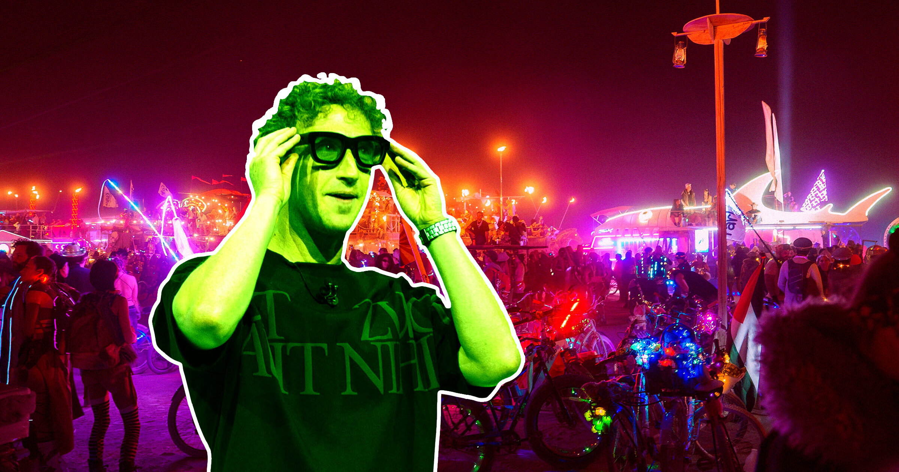

# 火人节也陷Meta AI眼镜风波

> 火人节遇上 Meta AI 眼镜难题：纽约夜店直接终身封禁偷带者，火人节却只写进“生存指南”——可用，但必须征得入镜者同意。社区吵翻了，有人要公开羞辱“眼镜怪”，也有人叹：硅谷文化早已渗透这片沙漠。

火人节现场与 Meta AI 眼镜的隐私争议

## 夜店封杀，沙漠放行

这个夏天，去内华达沙漠的人多了一个必答题：怎么对待 Meta 智能眼镜？随着争议升温，纽约夜店 Basement 已放话——偷带智能眼镜入场者永久封禁。

火人节的选择温和得多。组织者在上月更新的官方“生存指南”里写明：佩戴和使用智能眼镜可以，但“在使用任何设备——包括手机、相机或智能眼镜前，必须征得可能入镜者的同意，无论是主角还是背景路人”。

一硬一软，两种治理思路直接撞上。

## 社区想直接禁了它

粉丝并不买账。Reddit 的 r/BurningMan 上，一条“我们怎么在火人节禁掉 Meta 眼镜？”的帖子收到数百条评论，关键词是“间谍眼镜”和“glassholes”（眼镜混蛋）。

BLOCKQUOTE:公开羞辱就很好。在火人节，想让整个酒吧或花车一起反对一个眼镜怪太容易了。—— Reddit 网友

另一条更高票评论更直接：“狠狠羞辱戴的人，戴着这种眼镜来火人节的就是 creepy。”

但也有悲观派：“禁不了。好手机视频出现后，火人节和社会就明显变味了，这只是延续。”有人怀念更常裸体的年代——那时镜头还没这么无处不在。

## 激进包容撞上硅谷朝圣

这件事在火人节格外拧巴。它标榜“激进包容”，这些年却成了名人与富豪的 retreat——从马斯克到扎克伯格，硅谷朝圣者年年开拔，而他们正是最可能戴智能眼镜的人。

另一边，是在 playa 上裸奔、搞艺术、对 AI 和科技公司翻白眼、只想暂时逃离社会与数字监控的人。两群人共享同一片沙漠，镜头成了新的边界。

组织者没有一刀切，或许正说明它清楚自己的受众——至少是更有钱的那部分。至于羞辱能否代替规则，沙尘会给出答案。
