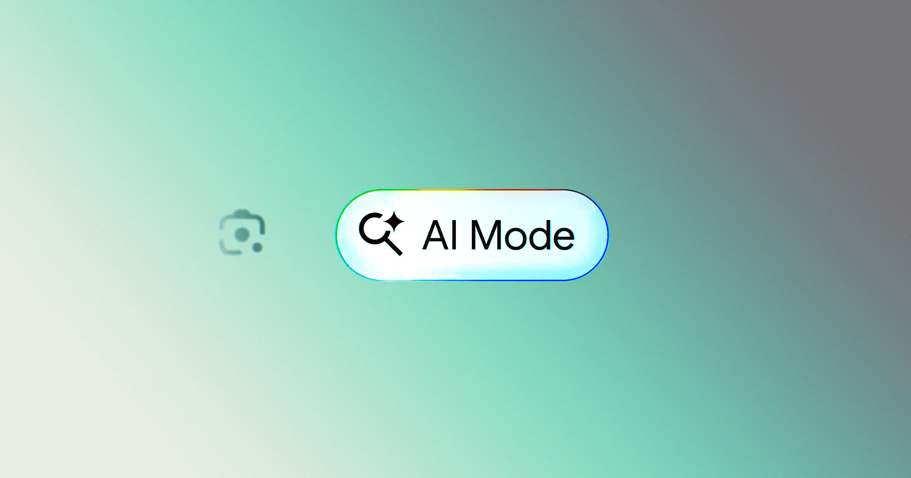

# 谷歌AI模式购物贵21%，被指变相加价

> 电商SEO公司Productrise实测：同一件商品在谷歌AI Mode中的标价平均比传统搜索贵21.6%，且AI推荐的卖家近半数不同，被质疑利用数据做“监督定价”。

谷歌AI Mode购物结果被指价格更高

## 同一件商品，AI里更贵

上月谷歌把首页标志性的“搜索”按钮换成了AI功能入口，购物体验也随之改变。Productrise对同一商品在两种模式下的价格做对比发现：AI Mode展示的价格平均高出21.6%。

这触及一个敏感议题——“监督定价”：企业用AI分析用户个人数据实时定制价格。实验并未直接证明谷歌在按用户画像差别定价，但AI Mode与传统搜索对同一商品给出不同价格、且差异系统性偏高，足以引发质疑：AI究竟如何挑卖家、定排序？

谷歌回应称：“我们尚未核实该报告的准确性，但包括AI Mode在内的所有购物结果都来自同一个数据源：Shopping Graph。用户可点进商品页对比不同商家报价。”

## 看得更高，却不一定更划算

研究还发现，AI Mode的商品卡片在页面中平均高出传统列表49%的可见高度，更容易被点到；且同一商品的主供卖家在两种模式下有近50%不一致——AI Mode明显偏向另一批、也更贵的商家。

独立SEO顾问Brodie Clark评价，这揭示了Shopping Graph在经典搜索与AI Mode间对免费展示位的“不一致”。

好消息是，消费者似乎并未照单全收：不少人会绕过AI卡片，继续往下翻找真正划算的报价。价格可以被AI抬高，但钱包仍由人管。
