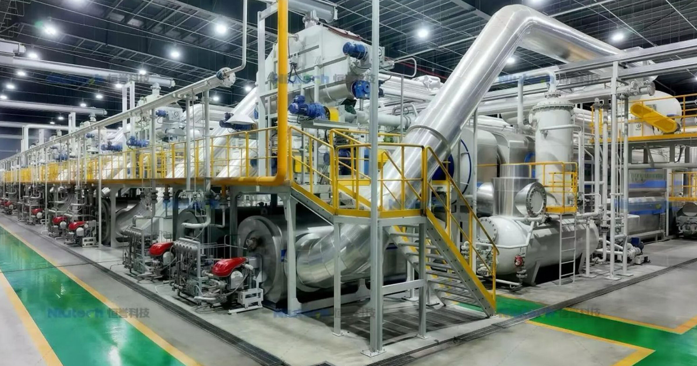

# 中国建塑料转航油巨厂，热解技术变废为油

> 欧盟2030年要求航油至少6%可持续、2050年至70%，废弃食用油已不够分。中国Niutech签下匿名大单，建全球最大塑料热解制航油基地，把废塑料裂解为可持续航油

中国企业用热解技术将废塑料转化为可持续航油

## 废油不够，废塑料来凑

可持续航油可来自植物、动物脂肪与废弃食用油，但后者已被抢购一空、流量见顶。Niutech在最新公告中宣布与匿名客户签下巨型合同，建设以废塑料为原料的航油设施——通过热解将塑料裂解为油品，再精炼为航油。

Interesting Engineering首次捕捉到该公告。这是全球航油脱碳压力下，首次出现以“塑料—航油”为路径的超大规模落地。

## 从垃圾场到跑道

欧盟、英国、新加坡、日本、巴西等地已密集出台掺混强制，航油市场正被迫寻找原油之外的碳源。若热解路径打通，海量难回收塑料将从填埋场直接上跑道——既解塑料危机，也补航油缺口。

变废为油的瓶颈不在技术，而在收集、分选与精炼成本。Niutech的规模化赌注，正是要把这条链条跑通。
