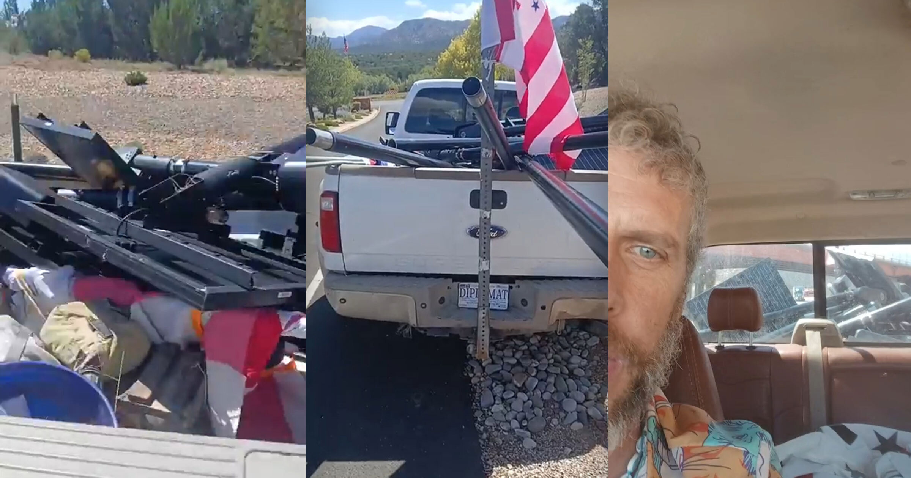

# 男子开皮卡拉一车Flock摄像头自首

> 别人拆Flock都蒙面，阿尔伯克基的Jevon Martinez直接开皮卡拉着一车拆下的ALPR塔架去警局自首：县里早已解约，摄像头却还立着，他帮警察“收摊”

男子拆下Flock摄像头后开皮卡送回警局

## 合同都解了，杆子还在

今年早些时候，伯纳利欧县已取消与争议监控公司Flock的合同，但自动车牌识别摄像头仍杵在路边。Martinez在社交媒体发布的多段视频被KOB4捕捉：他把摄像头塔架一座座放倒，装满皮卡后斗，开回警局。

“伯纳利欧县警局很忙我知道，所以我帮你们收一下，”他一边开车一边说，“搞了一堆这玩意儿。”另一段视频里，后斗堆满ALPR零件。

## 从偷拆到自首的反转

多数破坏者选择匿名，Martinez则反其道——不藏面，直接把“赃物”送回权利方，试图以“归还”而非“破坏”来定性行为。警局尚未公布是否立案，但视频已在本地引发对Flock“解约不拆机”现象的追问：合同终止后，监控硬件的存留与数据流向谁来监管？

一车Flock残骸开进警局院子，成了反监控运动最直白的注脚：当技术已失去授权，物理拆除成了最后的删除键。
