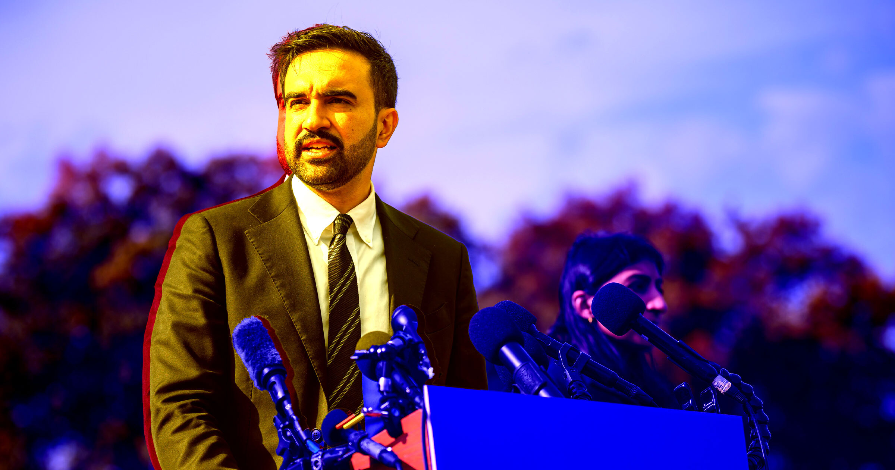

# 纽约市长禁8年级以下学生用AI

> 纽约市长Zohran Mamdani宣布全美最严校园AI禁令：小学至8年级一年内禁用AI，38项AI功能下线——“科技行业想让我们相信早教AI不可避免且必要，我不这么看”

纽约市宣布8年级以下校园AI禁令

## 一年禁令，38项功能下线

Mamdani周三宣布为期一年的暂停令，称这是“全国同类中最全面的”。新规下，学区将“全面停用或禁用”此前已准入项目中的38项AI功能，直至其符合新标准。禁令覆盖小学至8年级，高中不受限。

市长在发布会上说：“科技行业想让我们相信早教AI不可避免且必要，我不这么看。除了那些由牟利企业赞助的研究，我还没见过任何研究证明AI对小学和初中生有益。”

## 早教AI的合法性质疑

禁令把举证责任抛回给技术方：不是“为何要禁”，而是“请证明有益”。在生成式AI涌入课堂、作业与评估被重塑之际，纽约的选择为全美学区提供了一个强硬样本——先按下暂停，再谈如何用。

一年之后是否放开，取决于能否拿出非企业赞助的、经得起检验的证据。
