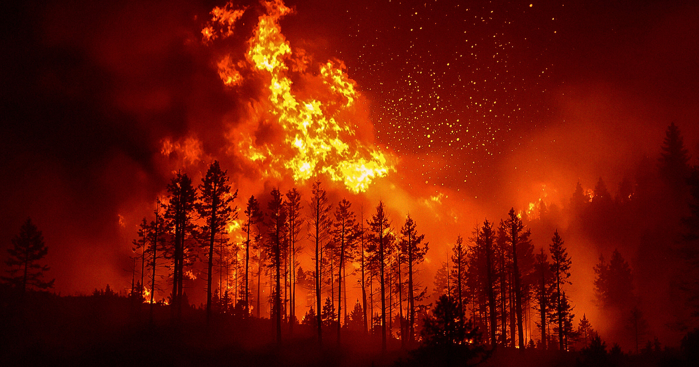

# 联合国承认气候治理失败，行星螺旋式坠入灾难

> 联合国环境规划署最新报告直言：世界必须面对“必然突破1.5度”的现实——这个曾被视为防线的阈值一破，将触发洋流崩溃、永冻土骤融与珊瑚系统坍塌

联合国报告承认1.5度温控防线已失守

## 1.5度，不再是目标而是必然

许多气候预测把2050年当远期锚点，让人误以为还有时间。联合国环境规划署的新报告打破幻想：呼吁“世界正视必然超过1.5度”的现实。这是自工业化以来升温的关键红线，过去被视为多重不可逆临界点的集合——大洋环流崩溃、北方永冻土突变融化、热带珊瑚系统瓦解。

报告发布前，地球刚经历有记录以来最热的夏天，多项减排路径已偏离。

## 螺旋式坠入

UNEP的措辞从“努力避免”转向“准备应对”：1.5度突破后，气候系统不再线性恶化，而可能螺旋式联动——海温升高削弱碳汇，碳汇削弱再加热海洋。问题不再是“能否守住1.5度”，而是“突破后如何减缓2度、2.5度的连锁冲击”。

当官方承认“已失败”，留给政策的不是安慰剂，而是适应与止损的硬账。
