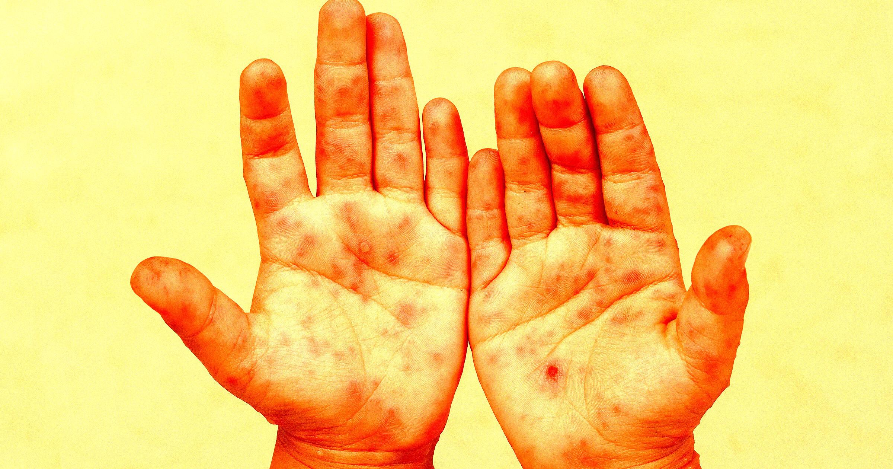

# CDC史无前例拒绝认定两儿童死于麻疹 与RFK Jr陷政治对峙

> 宾州报告两名未接种疫苗的儿童死于麻疹，CDC却在一份史无前例的声明中拒绝将其死因认定为麻疹，这场数据僵局的背后，是卫生部长RFK Jr与宾州州长Shapiro的公开对峙。

CDC史无前例拒绝认定两名儿童死于麻疹

## 州上报死因 CDC史无前例拒绝采信

宾州卫生部门确认两名幼儿死于麻疹病毒，但美国疾控中心（CDC）拒绝把他们的死亡计入麻疹死亡病例。CDC在官网发布了一则极不寻常的公告，称"本周的麻疹疫情更新将不包含宾州卫生部8月25日报告的两例麻疹相关死亡"。

这是一次史无前例的动作。《纽约时报》称之为"CDC的非常之举"，因为它打破了该机构长期遵循的惯例——向来直接采纳各州上报的数据。

## 死者细节与死因之争

两名死者均未接种疫苗，麻疹检测呈阳性，来自麻疹疫情中心兰开斯特县，该县目前已有242人感染，数量居全州之首。据最新报道，其中一名死者是新生儿，死于脾破裂；另一名儿童年龄不详。

关于死因的互相矛盾的信息，点燃了这场风波。宾州卫生部称两名儿童均死于麻疹，但兰开斯特县验尸官、共和党人Stephen Diamantoni却表示，其办公室的法医判定那名新生儿——生来即带母体感染的麻疹病毒——死于脾破裂并非麻疹。

## 专家反驳验尸官 麻疹可致脾肿大破裂

顶尖医学专家并不认同Diamantoni。费城儿童医院著名疫苗与儿科传染病专家Paul Offit在广受关注的Substack文章中写道，麻疹会使婴儿脾脏肿大，分娩时更易破裂；而脾脏一旦破裂，事后很难再判断它此前是否已肿大。

Offit呼吁Diamantoni提供新生儿死亡更多细节，并指出：新生儿脾破裂极为罕见，仅能由极少数疾病或感染引起，如果孩子身上找不到那些病因，那"唯一剩下的明显死因就是麻疹"。

这并不能解释CDC为何也拒绝计入另一名儿童的死因，而关于那名孩子细节极少披露。

## 政治对峙与数据僵局

CDC的挑战发生在卫生部长Robert F. Kennedy Jr（其管辖CDC）与宾州民主党州长Josh Shapiro的政治对峙期间。上周的新闻发布会上，Shapiro宣布两名儿童死于麻疹，并谴责Kennedy散布疫苗虚假信息，称"散布虚假信息有真实的人生代价"。

RFK Jr则在社交媒体上反击，指责Shapiro对死者之死感到"狂喜"，甚至暗示死亡或被"捏造"。CDC发布拒绝认定死因的公告，就发生在这次公开口水战几天之后。

主管CDC的卫生与公众服务部（HHS）在声明中为其决定辩护，称"宾州宣布的两例麻疹相关死亡，基于CDC目前掌握的信息尚未得到确认"，并称现有信息"反映的是最佳可用信息，以及我们对透明和向美国人民讲真话的承诺——这是特朗普政府的基本原则"。
