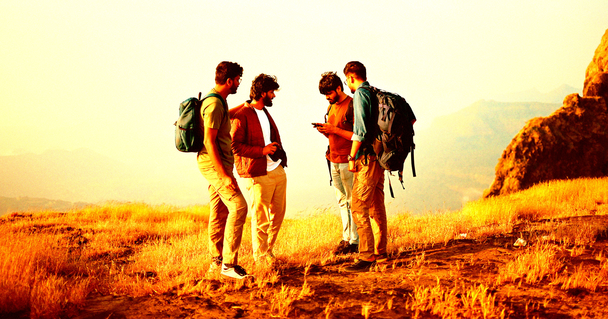

# 三名新手用Gemini规划登沙斯塔山 被AI建议少带粮水夜里被困获救

> 三名新手徒步者重度依赖Google的Gemini规划登顶加州沙斯塔山，听从AI建议少带了粮食和水，结果夜里困进峡谷、一人膝盖受伤，次日才被森林消防搜救队接回。警长警告：别只靠AI规划野外活动。

三人用Gemini规划登山，被AI建议少带粮水

## 彻夜登顶 误入峡谷

三名来自加州首府萨克拉门托郊外的年轻人，本月初试图深夜登顶内华达山脉沙斯塔山的14179英尺峰顶——这是座仍可能喷发的层状火山。此前徒步者被反复建议：中午前就该返程掉头，不要拖到入夜。

这三个"新手徒步者"最终在漆黑的夜里摸黑下坡。他们打电话给锡斯基尤县警长办公室求助问路，却选择偏离路线，误入邻近的一条峡谷，决定在那里过夜，其中一人膝盖受伤。据《芝加哥论坛报》报道，第二天早上，当地搜救志愿队和联邦林务局护林员不得不一路护送他们返回安全地带。

## AI建议少带粮水 八小时行程拖成数日

这是一场本可轻易避免的"尴尬之途"——如果他们听从人类专家的建议，而不是求助Google的AI。据警长办公室说法，三人是"被Gemini建议带上远少于团队所需的食物和水，尤其当他们计划的8小时登顶变成了一场持续数日的磨难之后"。

警长办公室在声明中提醒："登山前务必致电当地联邦林务局沙斯塔山护林站，确保拿到最准确的信息，绝不要只靠AI来规划行程。"

## 这不是第一起AI酿成的野外险情

这只是一连串徒步者盲从AI聊天机器人酿祸的最新案例。去年，在温哥华附近试图攀登一座山峰的徒步者，就在踩进雪地后被迫呼叫救援——他们穿着运动鞋，直到5月初仍积雪的山脉才缓过神，此前一直只看ChatGPT的建议。

我们也见过游客被AI聊天机器人领到危险地带、却根本不存在的地标。去年有两名游客试图前往安第斯山脉一个根本不存在的"乌曼泰山圣谷"。幸运的是，附近一位导游听到了对话，及时提醒他们远离危险。

那位导游Miguel Angel Gongora Meza去年10月接受BBC采访时说："海拔、气候变化和路径的可达性都必须规划好。当你用一个把图片和名称拼成幻想的程序时，你可能会在海拔4000米的地方发现自己既没氧气也没手机信号。"
