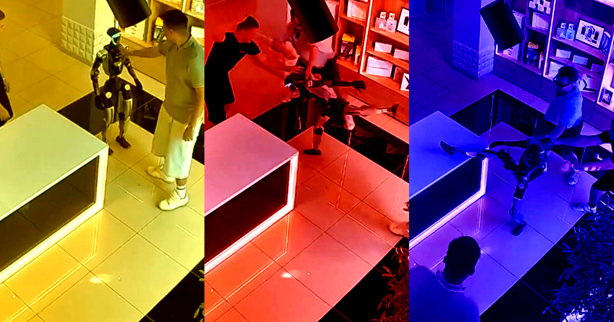

# 俄罗斯商店里被轻推一下，人形机器人放搏斗音乐开踢

> 一段疯传的监控视频里，俄罗斯某商店内有人轻轻推了一下中国宇树G1人形机器人，机器人先是后撤一步，随即响起搏斗配乐、摆出战斗姿态开踢，两名店员上前阻拦才作罢。

监控拍下：被推一下，人形机器人摆出搏斗姿态

## 被推一下，机器人开始"应战"

过去几年，人形机器人练出了不少本事：跑得比任何人类都快，还能跳出编排复杂的舞蹈。它们甚至被教会了打拳和踢拳——作为人类主人的娱乐节目。一名在俄罗斯逛商店的男子，似乎就为此付出了"惨痛"代价。

监控视频显示，这名顾客轻轻推了一把疑似中国宇树G1的人形机器人。机器人先是微微后撤，随后突然响起一段廉价的搏斗音乐，它随即两腿大开摆出战斗姿态，蓄势待发。两名店员立刻上前试图按住它，可机器人仍不断甩出技术性高抬腿。

其中一脚似乎踢中了目标——正好是其中一名店员的裆部。

二十秒后，这起"机器人袭击"戛然而止：机器人突然扬起双臂，摆出了一个T字pose收场。

## 有人笑，有人怕

社交媒体一片哗然。一位X用户写道："他们给那玩意儿装了个功夫揍人模式，我眼泪都笑出来了。"

也有网友态度严肃得多。有人发帖预言："用不了多久，机器人就会当街把人的胳膊扯下来。"

## 机器人真的叛变了吗？恐怕未必

现在就宣布"机器人起义"开始还为时尚早。这段视频留下的疑问远比答案多：我们不知道机器人是否被远程操控，是否只是在执行一段预设的动作序列作为技术演示。

当然，也完全有可能整场冲突都是排练好的——只为在社交媒体上博取流量。

视频里似乎没有人受重伤，但这也不是第一次有人被人形机器人弄伤了。比如说，我们就见过一段戴着小丑假发的机器人回旋踢无辜小孩的视频，还有机器人一拳打中男子鼻子、把人家打到流血的画面。
