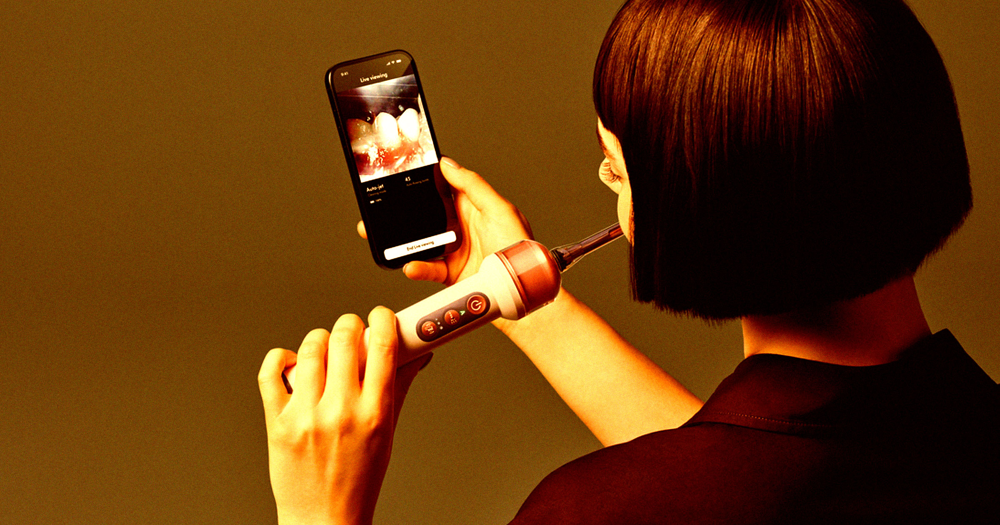

# 戴森AI牙刷内置10万像素镜头声称能看见牙医才看得见的

> 在美国人正把Flock监控摄像头一个个锯下来当民间英雄的当口，英国家电巨头戴森却推出了一款内置10万像素微距镜头、每秒分析28张图的AI电动牙刷CameraJet——它要给你口腔内部做"视频监控"。

戴森CameraJet AI牙刷内置10万像素镜头，号称能"看见牙医才看得见的"

## 一支装进嘴里的监控摄像机

戴森新发布的这款名为CameraJet的电动牙刷，搭载一颗"10万像素微距镜头"，官方宣称能让使用者"看见牙医才看得见的"。它每秒要分析28张图像，并用一套"AI机器学习算法"来识别和锁定牙缝间隙。

至于在漆黑的口腔里怎么拍得清，戴森用"频闪灯"解决了这个问题——官方称之为"精确照明，保证最优摄像可见度"。它还同时支持WiFi和蓝牙，理论上只要有人找出戴森软件的漏洞，这支牙刷的摄像头就可能卷进各种网络安全幺蛾子。

## 499美元的身价和"过度工程"

戴森创始人兼首席工程师詹姆斯·戴森在声明里不无得意："把相机、机器学习、精密流体动力学、先进刷牙技术和连接性、WiFi揉在一起，CameraJet为保持口腔健康开创了一种全新方式。"

当然，这套口腔内部拍摄的敏感视频监控是有代价的。这件显然过度设计的玩意——外形更像一支迷你卷发棒而不是你熟悉的电动牙刷——售价高达499美元，至少附赠两个刷头、一根充电线和一座"补充液底座"。戴森还顺带卖起"专利无泡牙膏"，特意剔除了常见的发泡剂月桂基硫酸钠（SLS），免得刷到一半满嘴泡沫糊住了监控镜头。

值不值这个价，戴森让你自己掂量：它号称动用了661名工程师，卖价抵得上一台iPad Air，或者约十支单价亲民的传统电动牙刷Oral-B Pro 1000——那是给不需要AI帮忙刷牙的人准备的实惠之选。
