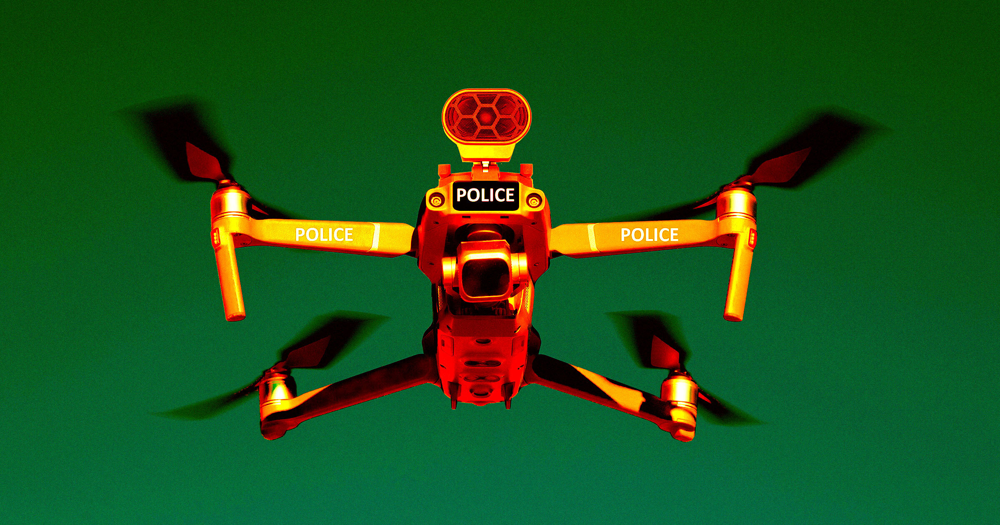

# 特朗普加征100关税无人机警方空中监控叫苦连天

> 特朗普周四对大型外国制造无人机加征100%关税，自称"巩固国安"，实则让依赖无人机空中监控的警察部门叫苦连天——单是中国大疆一家就占全球商用无人机七成多，替换谈何容易。

特朗普对大型外国无人机加征100%关税，依赖无人机空中监控的警方成本暴涨

## "国安"还是保护主义

特朗普周四对大型外国生产的无人机加征100%关税——他一向爱用整数、爱对进口加税。他声称此举"巩固国家安全"，但讽刺的是，据Ars Technica汇总各方评论，这反而可能削弱国内安全——至少对那些习惯了从空中俯瞰监视目标的警察部门而言。

克利夫兰外的湖县无人机部队负责人Scott Mlakar对《纽约时报》说，这笔关税"财政上负担沉重"，会让许多社区买不起无人机。他的队伍夜里用它追捕犯罪嫌疑人和搜救走失儿童。Mlakar直言："在我们看来，这主要是美国制造商为了消灭外国竞争所做的游说。这不是国家安全，这是保护主义。"

## 精准打击大疆

这份关税明确针对热门的中国无人机，同时给日本、台湾、韩国、欧盟等盟友制造的无人机豁免或征更轻的税。尤其需要注意的是，高额关税适用于使用热成像或重量超过55磅的无人机。此外，美国联邦通信委员会（FCC）还在考虑把lidar等部分无人机技术重新归类为"军用级别"，进一步限制谁能使用这些设备。

## 没得选的替代

无人机在执法之外还有大量实用价值，比如监控山火、协助救援。而在Flock遭公众反弹的背景下，它们也被越来越多地看作另一种监视机器。可按照特朗普政府的说法，摆脱对中国无人机技术的依赖"对美国国安有好处"。这里有个小问题：据《纽约时报》统计，单是中国公司大疆就占据了全球商用无人机的70%以上——想替换，谈何容易。

也有不少警察对关税怨声载道，盛赞中国无人机对他们作业的不可替代。Ars就注意到一位名叫Jason Lee的德州警官向FCC投诉，认为大疆"目前没有经济上可行的国内替代品"。他补充说："2024年接受调查的州和地方执法无人机项目中，超过80%使用大疆的飞机。"Lee还说："存在国产产品，并不意味着它就是可行的替代品。替代品必须在操作上可比、经济上买得起、供应链要跟得上，还得让那些必须在真实事件中依赖它的飞行员接受。"
