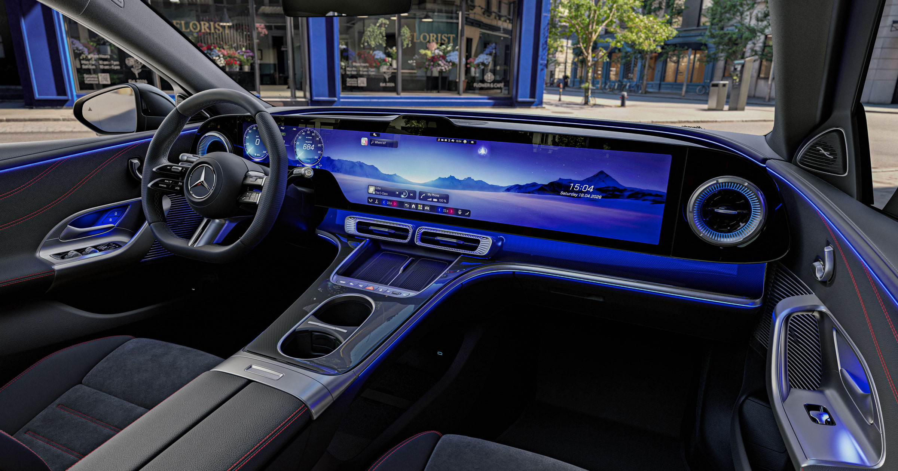

# 车主受够了车内巨型触摸屏：JD Power调查显示超1/3车主从不用乘客屏

> JD Power对6.8万名2026款车主调查发现，超过1/3的人从没用过乘客屏，仅6%每次用车都动它，而且大屏幕反而更容易出故障——车主真正看重的，是智能点火、智能空调这类安静低调、几乎让人察觉不到的功能。

JD Power调查：车主受够了车内巨型触摸屏

## 屏幕越做越大，却越来越没人买账

几乎每一家大型车企如今都在往中控台上塞越来越大的屏幕，这些面板常常一路延伸、越过驾驶座直抵副驾乘客区。但现实是，消费者对这些"豪华配置"越来越不感冒。消费者调研机构JD Power最新调查显示，2026款车型的车主正被这些巨型显示屏实打实地劝退。

在受访的6.8万名车主里，超过三分之一的人承认从没碰过乘客屏，只有6%表示每次上车都会使用。更糟的是，JD Power自己的调查还发现，屏幕尺寸越大，车载信息娱乐系统出问题的概率反而越高。

## 车主要的不是更多屏幕，而是"感觉不到"的好功能

调查共考察了40项面向消费者的车载技术，其中最受欢迎的清一色是那些最容易被忽略的功能，比如智能点火、智能暖通空调；而垫底的，恰恰是乘客区的中控触摸屏——这类屏幕此前还屡次被曝存在传统旋钮和按钮所没有的严重行车安全隐患。

JD Power客户成功总监多隆·希克里（Doron Hikry）在随附的新闻稿里点破真相："消费者最看重的技术，往往是那些好用到你几乎注意不到的技术。智能点火和智能空调让日常驾驶更省力，却不用分散驾驶员的注意力；相反，更多的自动化和额外的屏幕，并不必然带来更好的体验。"

## 高阶辅助驾驶也吃瘪

除了嫌弃大屏占地方，车主对L2+级驾驶辅助系统也不买账——这类系统允许驾驶员在某些路段松开方向盘，比如特斯拉争议缠身的"完全自动驾驶"（FSD）。调查显示，无论在设计还是实际体验上，车主都更偏爱老老实实的L2级辅助系统。

希克里补充说："这些结果表明，车主眼下可能更信任那些明确辅助驾驶员的系统，而不是那些引入更高程度自动化的东西。"这已是老生常谈的趋势——消费者对每一项功能都被埋进层层叠叠的触屏界面里感到越来越烦躁。好在已有部分车企捕捉到这股广泛的不满，回头启用更易上手、更不分散注意力的实体按键和旋钮来设计车内空间。
