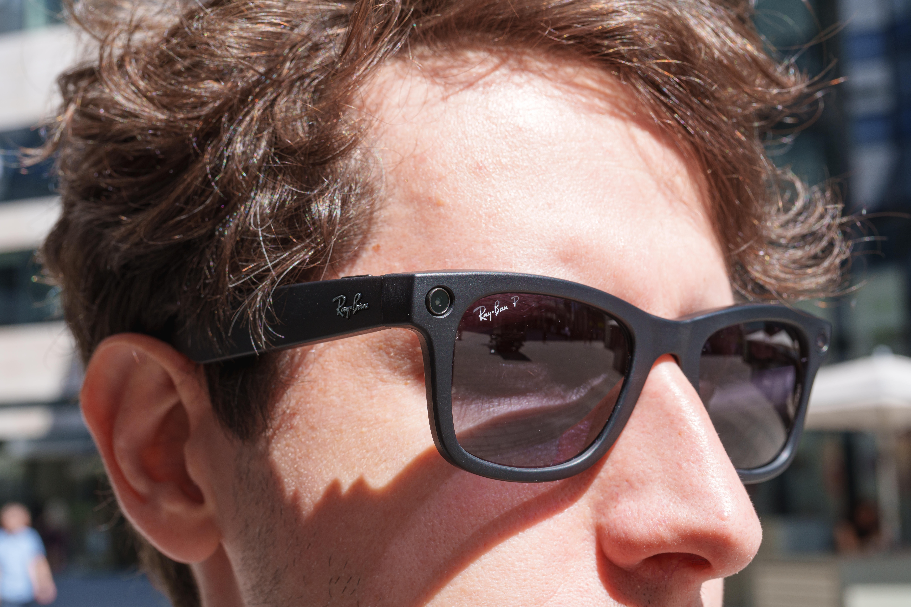

# Meta远程变砖改装眼镜专治偷录骚扰

> Meta开始远程禁用数千名用户智能眼镜的拍照录像功能——专治那些改装或遮掉录制指示灯、偷偷拍摄并骚扰他人的顾客；2025年售出700万副，被动手脚的比例虽不到千分之一，但滥用者远不止这几个。

Meta开始远程变砖改装版智能眼镜，打击偷录骚扰

## 远程变砖，专治偷录

Meta月初就放话，要打击那些改装眼镜、遮掉或毁掉录制指示灯的顾客——此前公众对这副眼镜被用来未经同意拍摄他人（尤其女孩和女性）并骚扰她们的行为反弹强烈。而到了本周二，它真的动手了：据Semafor报道，Meta通过一次软件更新，远程禁用了数千名用户眼镜的拍照和录像功能。

Meta没有给出确切数字，但其可穿戴设备副总裁Alex Himel对Semafor说，估计所有已售眼镜中被动手脚的比例不到千分之一。2025年这副眼镜卖出约700万副，换算下来最多约7000副，实际情况可能更少。

## 不只是几颗老鼠屎

这次打击的象征意义大于数字本身：它说明所谓的"变态眼镜"被滥用，远不是少数害群之马的事。几千副听着不多，但别忘了，这次整治只针对那些动手改装、把录制灯关掉的人——很多用这副眼镜偷拍别人的人，根本没改装过设备，也没打算隐瞒自己正在拍摄。

## 平台与民间齐动手

Meta旗下的Instagram最近开始封禁一些网红：他们戴着这副眼镜搭讪女孩和女性，还常常说出露骨挑逗的话。平台负责人Adam Mosseri誓言要"用一切我们能做到的办法"打击这种骚扰。

即便如此，这些努力仍是杯水车薪。据报道Meta还计划给眼镜塞进面部识别技术，让那些本就不相信Meta会为公众利益着想的民众决定自己动手：越来越多场所直接禁用智能眼镜，包括热门夜店；有人甚至在公共场合当面质问戴这副眼镜的人。

Himel自己也承认这是在逆风作战："这有点像猫捉老鼠的游戏……我不觉得这件事会有做完的一天，总会有新的办法绕过已有的防护。所以我们会继续监控，并不断进化我们的对策。"
