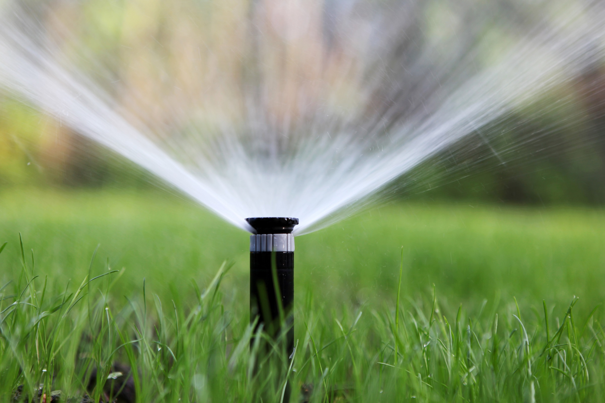

# 丹佛干旱限水数据中心却疯狂浇灌奢华草坪

> 丹佛遭遇数十年来最严重干旱，约150万居民每周被限只能浇两天草坪、上午10点到下午6点还禁止浇水，一段爆火的视频却拍到一座AI数据中心用喷头把整片草坪浇成"巨大水塘"，公众愤怒直指AI的耗水账单。

路人拍下丹佛一座数据中心在干旱限水期间疯狂浇灌奢华草坪

## 居民限量浇水，数据中心狂喷

今年三月，丹佛水务委员会在数十年来最干旱的条件下批准了一级旱情限制。据美国干旱监测数据显示，为丹佛水务供水的流域正处于"重度到异常干旱"，丹佛都会区则处于"重度干旱"。

于是居民和商户都被要求节制用水。丹佛人现在按地址分批，每周只能浇两天草坪；即便在那两天里，上午10点到下午6点之间也被禁止浇灌。就在大约150万用户老老实实执行限令的同时，一个举足轻重的大客户显然没打算关掉水龙头——一座全新的AI数据中心。

## 一段视频点燃的愤怒

社交媒体上一段已经爆火的视频里，丹佛Elyria-Swansea社区一位居民拍下了这座数据中心的整片草坪正被大量喷水。"你们该看看，那么多个喷头一起浇整片绿地，简直灌出一个巨大的水塘，"视频里的女子说。视频中具体是哪座数据中心尚无法确认，但很可能是云服务商CoreSite新落成的那座18兆瓦设施——占地约17万平方英尺，刚刚在Elyria-Swansea投运，此前还因丹佛的区划法规掀起了广泛争论。

目前不清楚哪些科技公司租用了CoreSite丹佛设施的机位，但在别处，这家公司曾高调与亚马逊、谷歌、微软等巨头合作。

至于这次浇草是不是违反限令，由于不清楚视频拍摄的精确时间，无法断言；也有可能该设施用的是循环水来灌溉——不过这条路子在其他城市曾被证明后果不堪设想。

按Gadget Review的报道，从10月1日起丹佛将全面禁止草坪喷灌，禁令一直持续到明年春天。倘若届时数据中心还在"喷"，当地官员究竟打算如何处理——甚至会不会处理——仍是未知数。
