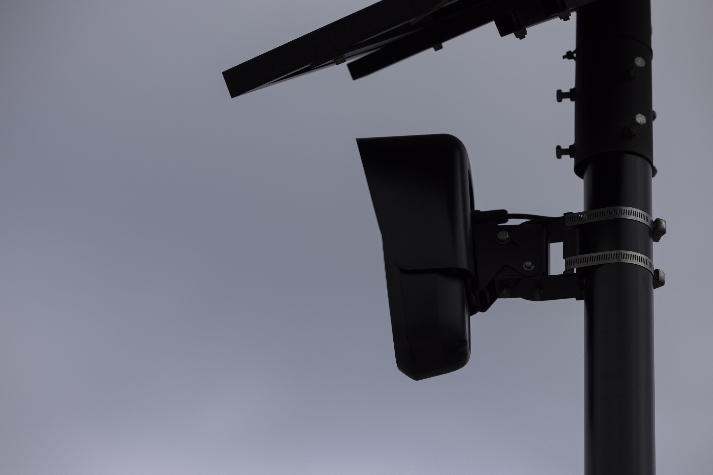

# 佐治亚男子被指用燃烧弹熔掉Flock摄像头面临重罪

> 佐治亚州25岁男子Colby Williams被指朝Flock车牌识别摄像头发射可燃烧物，把摄像头熔成冒着烟的金属塑料堆，面临故意毁坏财物、纵火等多项重罪——而抓他的，恰恰就是监控拍下的视频。

佐治亚男子被指用燃烧弹熔毁Flock车牌识别摄像头

## 烧熔三台摄像头，柱子上还贴了“DeFlock”

据亚特兰大当地媒体Fox5报道，25岁的Colby Williams被警方逮捕，原因是涉嫌放火焚烧了三台由极具争议的监控公司Flock安装的自动车牌识别摄像头（ALPR）。虽然起火原因尚不清楚，但至少有一台摄像头被发现“完全熔化”，残余的杆子上还贴着一张“DeFlock”（反Flock）贴纸。附近第四台摄像头则被发现有两个弹孔。

颇具讽刺意味的是，Williams正是栽在了ALPR自己拍下的画面上——监控拍到了一辆登记在他名下的车辆，警方顺藤摸瓜将其锁为嫌疑人。

## 重罪缠身，且摄像头只是“租”的

如今Williams面临四项故意毁坏财物罪、四项纵火罪，外加鲁莽行为和妨害政府财产两项指控。有意思的是，Flock采用的是一种被称为“硬件即服务”（hardware-as-a-service）的模式——这些ALPR设备并非警方的财产，而是Flock租给执法机构的。

用火来对付Flock的ALPR，目前看来还是头一遭。此前反监控的民间人士最常用的招数，不过是手锯、电钻，再不济就是喷漆。

## 支持者在评论区“火上浇油”

社交媒体上，不少支持者不但没有批判，反而为Williams叫好，还顺带炮轰部署这些摄像头的警局。“说到底就一句话：要么你们把它们拆了，要么有人会拆！”一名Facebook用户在Fox5那条逮捕报道下留言。另一位评论者则打起了爱国牌：“肯定不是他，他当时在图书馆重读《宪法》呢！”

燃烧弹、弹孔、贴纸、评论区里的叫好——一场围绕车牌识别摄像头的民间反抗，正从锯倒升级到烧熔。
