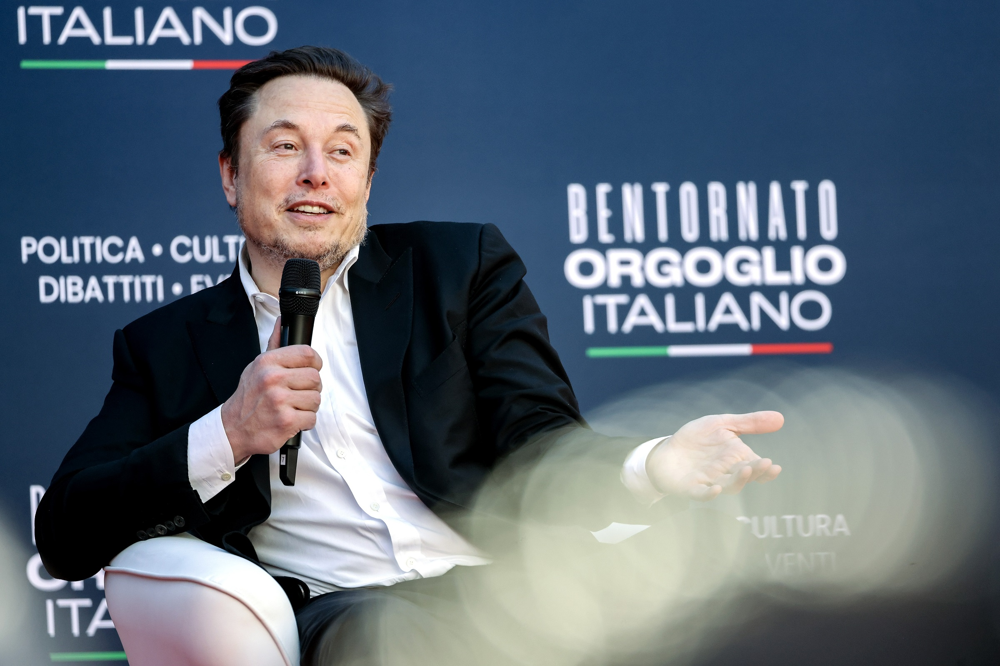

# 马斯克坚称自己比国际象棋AI更懂棋遭群嘲

> 马斯克在X上跟国际象棋权威平台兼棋类AI Chess.com较上了劲，坚持认为棋类AI根本不够看、国际象棋迟早被“完全解算”，结果被对方一句“技术问题”和全网嘲笑怼了回去。

马斯克在X上与Chess.com争辩国际象棋的棋局规模

## 嫌全宇宙的原子都不够“有趣”

事情起因于一条讨论国际象棋所有可能走法数量的帖子。按马斯克“全知”的标准，这个数字——比可观测宇宙里所有原子还多40个数量级——依然不够大、不够有趣。

“不彻底愚蠢的走法，实际上少得可怜，”他断言，“国际象棋总有一天会被完全解算。”话音未落，Chess.com带着一句简短反驳杀入战场：“技术问题。”（skill issue）

## 越辩越拧巴

这句嘲讽正中下怀。“棋对人类难，对计算机不难。有一天它会像跳棋一样被彻底解算，”马斯克几乎是重复自己，“在那之前乃至之后，尽情享受吧。很多游戏和运动，机器都比人强得多。”

讽刺的是，马斯克一边贬低棋类游戏，一边却承认自己正把时间浪费在“跟某个随机实习生吵架”上——“我可是全职员工，”Chess.com官方账号连忙澄清。他还搬出一套关于超级人工智能的宏大叙事，称未来AI会找到“远超我们理解力的解算与压缩方法”，甚至拿自己和自家聊天机器人Grok的对话当论据，仿佛这样就能一锤定音。

## 这不是技术讨论，是看不起棋

围绕“解算国际象棋”其实有正经的数学争论可谈，但马斯克的发言几乎全由轻蔑驱动。国际象棋从来是他的老眼中钉。早在2022年，他就发过一条著名推文：自称小时候之所以不玩国际象棋，是因为觉得“它太简单，在真实生活里派不上用场”，转而盛赞手机游戏《波利托皮亚》（Polytopia）才是高段位玩家的选择。

这次吵架里的态度如出一辙——回应另一账号时，他写道，自己“觉得下棋在迁移学习、理解现实方面的边际收益在递减”。下次你在棋盘上被对手碾成渣，或许可以试试把这句当借口。
