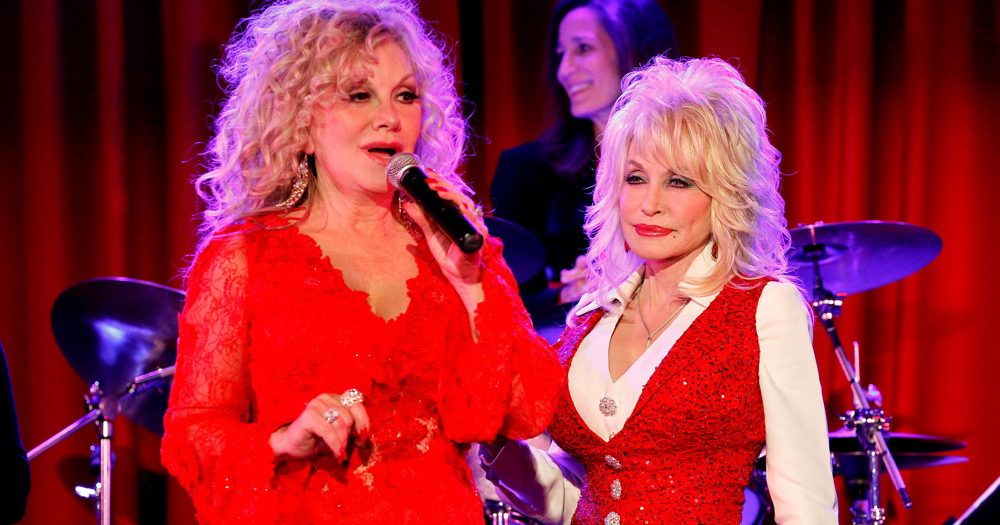

# Dolly Parton妹妹恳求网友：别再发假AI垃圾"悼念"她了

> 传奇乡村歌手Dolly Parton去世数周后，她的妹妹Stella Parton公开发声恳求网友：别再用"假AI垃圾"充当悼念——那些以假乱真的AI图片和AI生成歌曲铺天盖地，让她难以走出丧姐之痛。

Dolly Parton的妹妹Stella公开呼吁粉丝停止发布AI生成的"假悼念"内容

## 悼念变成了AI垃圾场

纪念一位逝者的方式有很多：献花、画壁画、点烛守夜——而在今天这个时代，还多了一样：AI垃圾（AI slop）。

Dolly Parton去世数周后，她的妹妹Stella Parton恳求粉丝停止发布那些所谓的"AI悼念"内容。她在社交媒体上发表的声明里写道："遗憾的是，因为我们的生活一直暴露在公众面前，我们别无选择，只能承受来自陌生人的巨大压力和冷漠。每天都有海量的AI内容和无穷无尽的垃圾被发布出来，消化或无视它们都让人心力交瘁。"

Stella先是感谢了那些给予"真诚支持"的粉丝，随后呼吁大家在纪念Dolly Parton、走出丧亲之痛的过程中"多一些同情心"。"重要的从来不是最俏皮的评论、假AI垃圾，或是刻薄的推文，"她写道。

## 八十年人生，找不到一张真照片？

Dolly Parton在这个世界上活了八十年，其中近六十年都是名人。那些用AI生成她诡异影像的人，真的翻遍她海量照片档案也找不出一张真实的吗？

美国总统特朗普就传播过这种"AI垃圾"：Dolly Parton去世后，他生成并发布了一张极具个人风格的图片——自己和Parton并肩而立、手挽着手。这简直是对真人的侮辱：Parton生前努力保持超然于党派政治之上，同时公开支持同性恋与跨性别者的权利，而这恰恰是特朗普坚决反对的立场。

## 150万播放的"麦莉悼念曲"也是假的

YouTube上还有一段"麦莉·赛勒斯（Miley Cyrus）为Dolly Parton献上的粉丝自制深情悼念"视频，只是众多据称出自流行巨星之手的AI悼念内容之一。这类视频疯狂传播，其中一些播放量已超过150万次。只是"深情"二字用得未免太松——据BBC核实，整首歌和其他同类内容一样，完全是AI生成的。

Parton本人对AI的态度本就矛盾：她曾设想AI在科学和医学上"可以很了不起"，但也担心它会取代人类的表达。换句话说，如果她还在世，几乎肯定也不会认可这些AI悼念。2023年她接受《好莱坞报道者》采访时说过："我认为这些东西用对了地方可以很伟大，但不能用来取代人的声音和文字，也不能取代一个属于上帝的人。"
