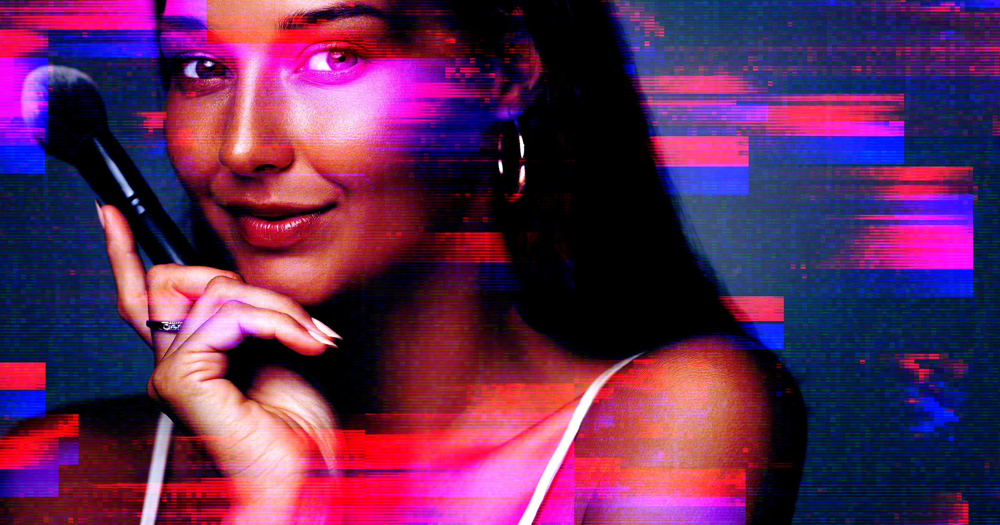

# Sporty & Rich创始人用AI拍电商大片失败 称AI永无人类品味

> 时尚品牌Sporty & Rich创始人Emily Oberg公开了她的AI试水结论：用AI生成电商大片省了钱，效果却一塌糊涂——“AI永远不会像人类那样拥有好品味”，她也因此打消了对AI会取代创意工作的担忧。

Sporty & Rich创始人Emily Oberg：AI生成的产品图"空洞、毫无情绪"

## 一次昂贵的省钱实验

在个人Substack专栏Emily Loves里，Oberg复盘了她把AI引入品牌运营的尝试。Sporty & Rich是她在2018年创立的时尚生活方式品牌，源头是她在网上整理的一组风格灵感图板（moodboard）。这次她把AI用在了电商产品图上——结果，按她自己的话说，实验失败了。

Oberg在文中写道："随着AI崛起，围绕它威胁创造力、就业乃至整个社会的讨论越来越多，但我坚信它永远不会像人类那样拥有好品味。正因如此，我觉得它对创意工作者的威胁并没有人们想象得那么大。"

## 一年两季、每季20万美元的拍摄

电商图片是Sporty & Rich最烧钱的支出之一，每半年一次的拍摄成本"超过20万美元"。为了绕开这笔开销，品牌用AI生成了上一季产品的电商图。图像确实比真人模特拍摄、后期修图便宜得多，但省钱是有代价的——成片质量实在拿不出手。

"这是我以为可以省钱的一个环节，但看完成片后，我决定回到由全人类团队来制作我们的电商内容，因为AI永远达不到我现实团队的水平。"Oberg坦言，AI出图总带着"某种了无生气的感觉"。

## 模特的眼神是死的

她对AI成片的批评相当具体："画面扁平，造型平庸，图片又'完美'得不对劲。模特眼睛里没有光，没有任何自然的动态，画面空洞，抽干了所有的情绪和情感。"

Oberg把这次失败归结为一个判断：品味是"感受出来的，不是学出来的"。图像生成模型说到底只是学习模型，没有真实生活的阅历，自然谈不上形成独特的世界观，更缺了一种说不清道不明的"je ne sais quoi"。品味本是人与人沟通的通道，却常常无法用语言解释。"世界上最聪明的AI能学会关于品味与风格的一切知识，"她说，"但那种感觉永远不会出现。"

## 一场关于审美是否可复制的赌局

有意思的是，这场AI实验恰好发生在Sporty & Rich这类品牌身上——它与Glossier、Goop一样，是2010年代靠Pinterest、Tumblr、Instagram起家的"审美驱动型"商业的代表。Oberg当初正是把一组精心挑选的图片提炼成感觉，装进了一个倡导"健康即财富"的产品线。如今连最前沿的AI模型都无法复刻那种令人满意、甚至"像人"的感觉，恰恰说明了它在创意领域的天花板。

"真正有好品味的人不追随潮流，他们创造潮流，"Oberg写道，"而且是不经意间创造的——他们只是做自己、喜欢自己所爱，不是因为算法或AI叫他们这么做。"

留下的悬念是：当省钱的诱惑足够大，还有多少品牌愿意为"人味"继续买单？
