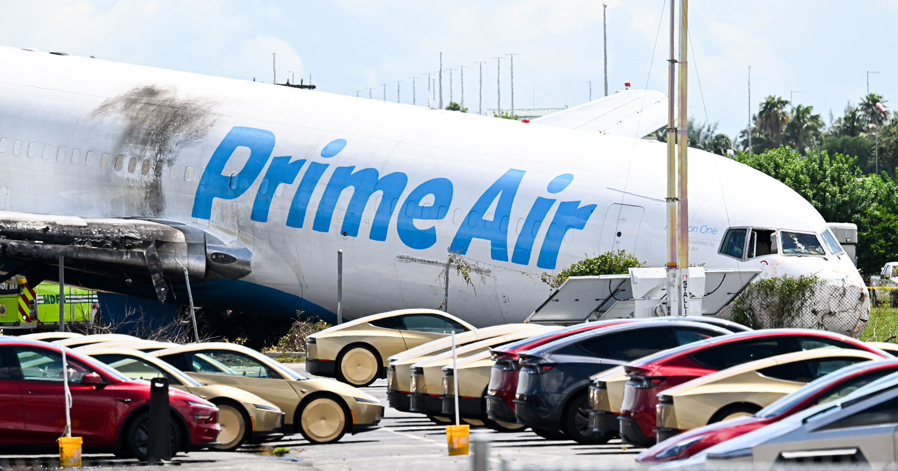

# 亚马逊货机冲出跑道 撞进停满特斯拉Cybercab的停车场旁 5人遇难

> 周日午后，一架亚马逊Prime Air波音767-300货机在迈阿密国际机场滑出跑道，撞上保洁人员和一辆SUV，造成5人死亡——更戏剧性的是，机身冲断围栏后停在距离一群特斯拉Cybercab仅几十英尺的地方。

冲出跑道的亚马逊货机停在停满特斯拉Cybercab的停车场边，机鼻被撞凹陷

## 机头距Cybercab车队仅数英尺

悲剧发生在周日下午的迈阿密国际机场。一架亚马逊Prime Air货机冲出着陆区，没能及时刹停，越过跑道尽头后撞上了一支保洁队伍和附近一辆SUV，机上与地面共5人遇难。

这架波音767-300还撞穿了机场一道铁丝围栏——围栏保护着一批极不寻常的车辆。现场照片显示，客机凹陷的机鼻停在距离一群停放中的特斯拉Cybercab仅几十英尺的地方。这款金色无人驾驶小车最多只能坐两名乘客，既没有方向盘也没有踏板。

## 马斯克的回应只有一个词："Weird"

特斯拉CEO马斯克把公司的未来押在了这款无人驾驶出租车上，而它在致命空难新闻里的意外"出镜"显然让这位亿万富翁措手不及。但令人侧目的是，事故发生后他并没有先表达哀悼，而是在推特上只发了一个词："Weird（奇怪）"。

Cybercab的乱入也引发一连串疑问：特斯拉到底有没有打算在奥斯汀以外推广这款车？就在上周，Cybercab才首次在得州奥斯汀上路运营，而特斯拉至今没有宣布任何即将在迈阿密投放的计划。

## 一款争议缠身的无人出租车

上周的奥斯汀投放让美国国家公路交通安全管理局（NHTSA）的监管者们紧盯不放——那次部署距离特斯拉首次亮相Cybercab还不到两年。据Bloomberg报道，那场信息量稀薄的发布会"出人意料地低调"，既没有直播也没有媒体采访。

"Cybercab发布会基本算个哑炮，"Future Fund Advisors联合创始人Gary Black在推特上写道，"发布内容细节寥寥，关键问题依旧没有答案。"确实，对于没有传统驾驶操控装置的车辆，监管审批至今模糊不清——这个话题对特斯拉尤为切身。马斯克把整个公司的未来都赌在了Cybercab和人形机器人Optimus的成功上。

如今两者都看不到大规模落地铺开的迹象，华尔街恐怕还得继续追问一堆棘手的问题。
