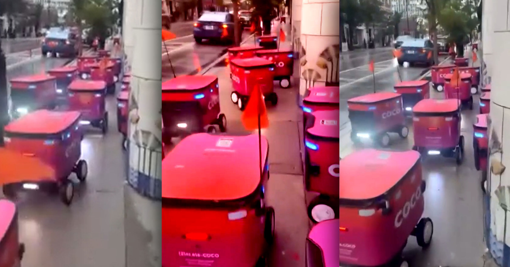

# 芝加哥送餐机器人又闯祸：集体故障群聚人行道

> 十几台送餐机器人像中了邪一样集体"扎堆"在芝加哥窄小的人行道上打转，把路堵得难以通行——此前它们已经撞伤过路人、撞坏过公交站台，官方甚至为它们划出了禁行区。

多台送餐机器人因故障聚集在芝加哥林肯公园附近的人行道上

## 晨跑撞见"机器人车龙"

芝加哥居民Becca Ostein在晨跑时拍下了这一幕：林肯公园附近一条窄小的人行道上，十几台由送餐公司Coco运营的机器人挤成一团，车载灯不停闪烁，像集体"迷路"一样卡在原地；远处还有一台机器人独自游走，看不出是想赶来支援，还是想逃离现场。"今早的跑步路线太挤了。"Ostein在视频配文中写道。

视频评论区几乎一边倒，有人留言："作为一个残障人士，这简直是真实的噩梦。"Ostein事后接受CBS新闻采访时形容，那些机器人"明显在群聚，好像根本没有要去的地方"，"没有灵活的脚，谁都别想从它们中间穿过去"。

## 前科累累：撞进医院、撞坏公交站

送餐机器人在芝加哥的口碑并不好。投入街头没多久，它们就把居民撞进了医院、撞坏了公交站台，地方官员为此划出"禁行区"，禁止相关公司在市内特定路段运营。如今又闹出群聚人行道这一幕，难怪市民积怨已深。

事发后，Coco在Ostein的帖子下留言道歉，承认"这不符合我们机器人的设计运行方式"。"我们的团队很快发现并处理了问题，机器人在几分钟内就清场并恢复正常运行，"公司补充说，"我们已确保这种事不会再发生。"

## 道歉容易，信任难修

十几台机器人同时"抽风"堵死一条窄人行道，倘若当时路过的是行动不便者或视障人士，后果不堪设想。Coco承诺"不会有下次"，但芝加哥人对满街乱窜的机器人已经攒下太多糟糕记忆——机器人的安全底线，不能总靠事后一句道歉来兜底。
