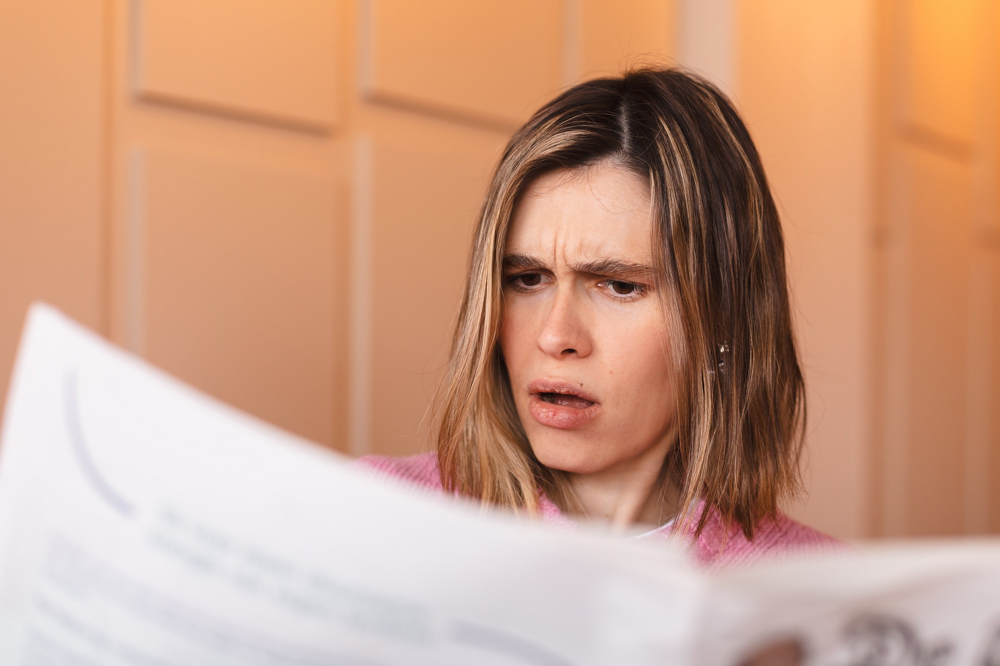

# 记者度蜜月时署名被挂上AI文章怒斥Cleveland.com

> 正在度蜜月的克利夫兰政府记者Kaitlin Durbin发现，雇主Cleveland.com用内置AI的"Express Desk"生成的一篇本地新闻竟挂上了她的署名，而她"一个字都没看过"，她在X上怒问：他们是不是以为从此拥有了我的名字？

康涅狄格记者度蜜月期间，署名被擅自挂上AI生成的文章

## 一篇与她毫不相干的AI文章

这名记者指控的是Cleveland.com——俄亥俄州最大报纸《Plain Dealer》的线上阵地——未经她的同意、知情或批准，就把一篇文章挂在了她的署名下。文章由"Cleveland.com Express Desk"生成，这家报纸声称该部门"使用AI工具协助产出内容"，且内容"经过员工审核和编辑"。

在9月7日的一条X帖子中，Cleveland.com的政府记者Kaitlin Durbin说，雇主在她外出度蜜月时，用她的名字发布了这篇AI生成的文章。那篇本地新闻是告诉读者俄亥俄州凯霍加县的法务专员即将卸任——与Durbin的报道毫无关系，她坦言自己对它"一个字都没写过，也没审核过"，就那样发了出去。

## "他们是不是以为从此拥有我的名字？"

"我正试着弄清楚，为什么上周我在度蜜月时，这篇报道带着我的署名发布了。我一个字都没写过，也没审核过，而且它没有采用我过去报道里的任何信息，"Durbin在X上写道，"难道Cleveland.com觉得自己从此拥有了我的名字？"

在被常规工作时间之外联系时，Cleveland.com没有立即回应置评请求。目前这篇文章已更新、删除了Durbin的署名，并加了一条更正说明："注：本文已更新以更正署名。记者的署名被错误地加到了这篇报道上。"

## 一个把AI当"未来"的报社

Cleveland.com早在二月就掀起过波澜——当时主编Chris Quinn发表致读者信，谈及报社创建AI新闻编辑室的决定。信中把AI吹捧为新闻业的"未来"，还批评新闻学院和求职中的记者没有全力押注这项技术。

"人工智能对新闻编辑室来说并不坏，"Quinn在信中写道，"它是新闻编辑室的未来。"他还辩称AI只是用来加快真人记者工作速度，能解放他们去做更多报道。当时，《Plain Dealer》与Cleveland.com公共利益与倡导版编辑Leila Atassi还向《哥伦比亚新闻评论》保证，报社AI新闻编辑室发布的报道依旧是"一位真实记者的成果"。

"这才是真正的问责，"Atassi当时说，"AI是助手，但它不是记者。"如今，那篇Cleveland.com报道已经完全没有署名，到底是谁的报道素材生成了这篇文章，也没人说得清。
