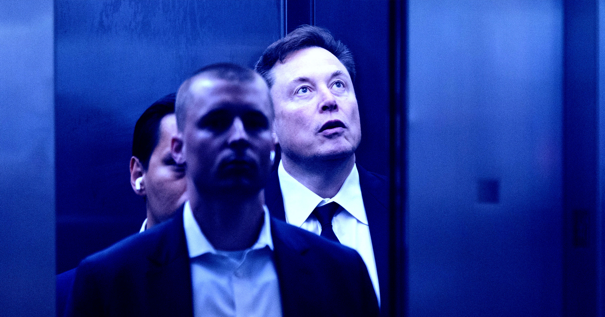

# 这部新纪录片让马斯克真的慌了

> 揭马斯克老底的纪录片《Musk》在威尼斯电影节全球首映，片长四小时；爆料称马斯克为使片中人物闭嘴不惜砸重金"封口"——而据传他本人正为这部片子"慌得不行"。

关于马斯克的长篇纪录片《Musk》在威尼斯电影节全球首映

## 四小时"黑历史全景"

马斯克这些年攒下的"素材"实在太多：冒犯性言论让他树敌无数、带头砍掉人道主义援助、压榨自家公司工人、插手民主进程，还因常年承诺多、兑现少而得罪投资人。这些都成了纪录片导演、调查记者出身的Alex Gibney的绝佳素材——新片《Musk》9月8日在威尼斯电影节世界首映，片长四小时。

《好莱坞报道者》评价称，这部片子细节上谈不上全新，但"整体杀伤力极强"，与近年媒体娱乐业产出的作品截然不同——"一幅权力肖像，气势堪比《国王班底》，潜在的社会影响力或可比肩《五角大楼文件》"。

## 马斯克急了：又是封口费，又是骂街

据记者David Sirota爆料，马斯克对这部片子"慌得不行"，因为Gibney"从不留情面、从不退缩、也吓不倒"。"于是，霸凌者恼了。"Sirota在X上写道。

报道称，马斯克为使片中受访者闭嘴使尽手段，有些并未成功。与他育有子女的前伴侣、在片中"出镜分量很重"的26岁网红Ashley St. Clair在威尼斯告诉媒体，曾有人开出4000万美元的价码，让她"选择不开口"。"当你收到这样的提议，心里难免会盘算：我的话到底意味着什么、值多少钱、他们为什么要花这么大价钱让我闭嘴？"St. Clair说。她是已知与马斯克育有14个孩子的4名女性之一；两人闹翻后，她曾指控马斯克因她提交抚养权申请而"经济报复"——削减子女抚养费。

## 骂导演"烂人"，也挡不住片子上映

马斯克上周已在X上预告火力：Gibney"显然会拍出他能想到的最有说服力的烂片来黑我"，还骂他是"骨子里坏透的烂人"。但以马斯克为世界贡献的海量素材，这样的片子恐怕会一部接一部。威尼斯首映只是开始，接下来他还能拿出什么招数，值得围观。
