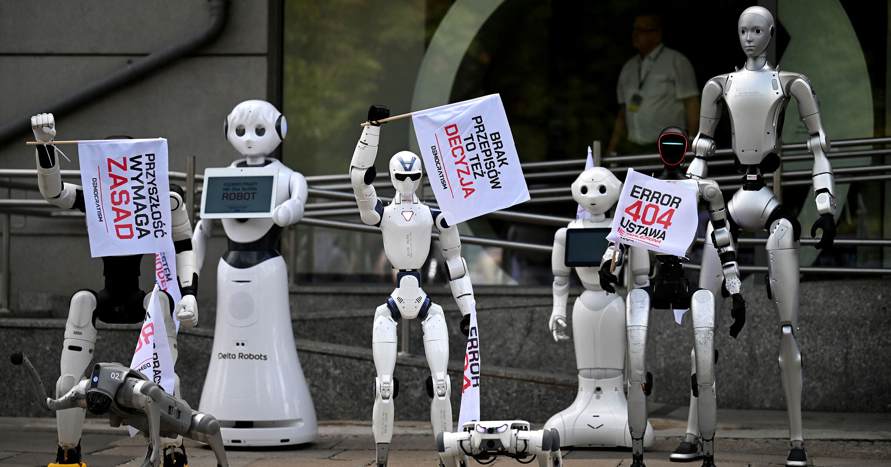

# 几十台人形机器人举牌游行抗议AI

> 约30台人形机器人挥舞标语在华沙街头"游行示威"，抗议AI抢走人类工作——组织者称，这是人形机器人第一次被用于政治示威。

数十台人形机器人聚集在波兰华沙街头举牌"抗议"

## 用机器人"反AI"，以毒攻毒

AI裁员、自动化的坏消息占据新闻头条之际，波兰一个团体选择"以毒攻毒"：让机器人替人类上街抗议AI。这场别开生面的集会由波兰组织Democratism发起、法新社率先报道，地点选在华沙的波兰数字事务部办公楼外。约30台人形机器人举着要求"尽快立法监管AI"的旗子聚集在一起——虽然人形机器人技术仍处在萌芽期，几十台机器齐聚街头的画面已经颇具冲击力。

组织者向记者解释，动用机器人正是为了展示机器人技术与AI眼下的真实状态。"现场的这些机器人就是要告诉大家，这项技术已经是现实了。"替组织者说出这句话的是一台Agibot A3——它集成了语音识别与大语言模型。

## "再不反应，很快就来不及了"

Democratism组织者Grzegorz Kuliś对法新社强调，他们尤其想呼吁各方正视"人类被取代"的隐患：被抢走工作的不只有蓝领，认知型工作同样面临AI与人形机器人的挤压。"如果我们现在不做出反应，可能很快就麻烦缠身……这些机器人已经能自由走动，它们已经在'抗议'了。"

耐人寻味的是，Kuliś本人是机器人公司Delta Robots的首席信息官兼老板，这场"公益演出"顺带也为自家产品赚足了曝光。报道提醒说，Anthropic、OpenAI等AI大厂一边渲染自家模型的能力、一边呼吁加强行业监管，同样常被指"醉翁之意不在酒"——Kuliś是不是在效仿Sam Altman的自利套路，目前还看不出来。

## 人形机器人首次"参政"

无论动机如何，这已经是已知范围内人形机器人第一次被用于政治示威——而且大概率不会是最后一次。
