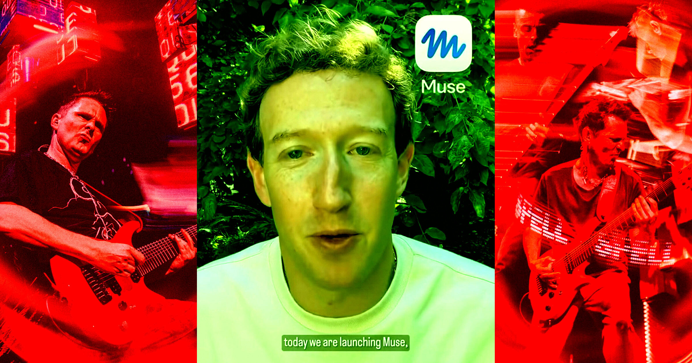

# 扎克伯格把摇滚乐队Muse的Instagram账号抢给新AI

> 周二Meta宣布了一款同样叫Muse的“个人AI助手”，英国摇滚乐队Muse用了十多年的Instagram账号 @muse（近300万粉）就这么没了，被迫改名 @museband，X上也不得不退居 @musetheband——粉丝和网友集体炸锅。

扎克伯格的新AI抢走了摇滚乐队Muse的原名账号

## @muse，被Meta的AI接管了

Muse这支英国摇滚乐队，几十年来一直是各大体育馆的开票大户，如今在Instagram上却不再是 @muse 了。就在周二，Meta（Instagram的母公司）宣布推出一款同样叫Muse的“个人AI助手”，而这个新AI顺理成章地占下了乐队原本的账号。

看乐队官网的存档就知道，就在上个月，他们手上还攥着 @muse 这个账号；现在他们只能改用 @museband，因为扎克伯格显然不愿让自己的新工具屈就于 @museAI 这样的后缀。X平台上也发生了同样的换号——Meta的新AI拿到 @muse，乐队则被迫退到更绕口的 @musetheband。这一套操作，活像是科技巨头对一个多年老用户名来了一场“企业征收”。

## 粉丝炸锅：有为乐队抱不平的，也有骂“卖身”的

账号易主几乎是被粉丝第一时间发现的，而大家对Meta的命名套路普遍不买账。一条爆火的Reddit帖子称，Muse是“被迫”改社交账号，瞬间点燃更多怒火。有粉丝气得直呼“这真是最烂操作”，也有人干脆开骂“马克·扎克伯格真是个loser”。

当然，音乐圈的老传统也没缺席——一些粉丝开始指责这支英国乐队“卖身”，想当然地以为Muse收了科技巨头一大笔钱，才肯交出社交账号。

## 背后发生了什么？没人说得清

这场换号究竟是怎么谈成的，目前仍是一团迷雾。鉴于Instagram和X两边同时发生，一种可能是Meta与Muse达成了某种协议——毕竟乐队守这个号已经超过十年。但Meta没有立即回应“交接是否自愿、乐队有无得到报酬”的问询，乐队本身也同样保持沉默，让事情更难看清楚。

动不动就夺走某个用户的用户名，社交平台其实早有“前科”。2023年马斯克把Twitter改成X时，就顺手拿走了 @X 这个自2007年起就被人占用的账号，公司给的原主“补偿”，只有一点周边产品和一次参观X总部的机会。

## 直播翻车：扎克伯格发帖还误@了乐队

这场换号比扎克伯格预想的要热闹得多。据《纽约时报》科技记者Mike Isaac发现，扎克伯格似乎是从Threads复制了自己的Muse官宣文案，粘贴到X发布，结果意外@到了真正的乐队——这疑与X端的一个bug有关，也导致人们想@新AI时，自动补全成了乐队的旧ID。乌龙接二连三。一位Meta的高级主管还发文吹捧：“我用了几个月 @museband，老实说这是我用过最好的AI agent。”——当然，这条帖子随后已被更正。

新AI抢下了一个极具辨识度的名字，只是它背后的主人，最想@到的可能并不是那支摇滚乐队。