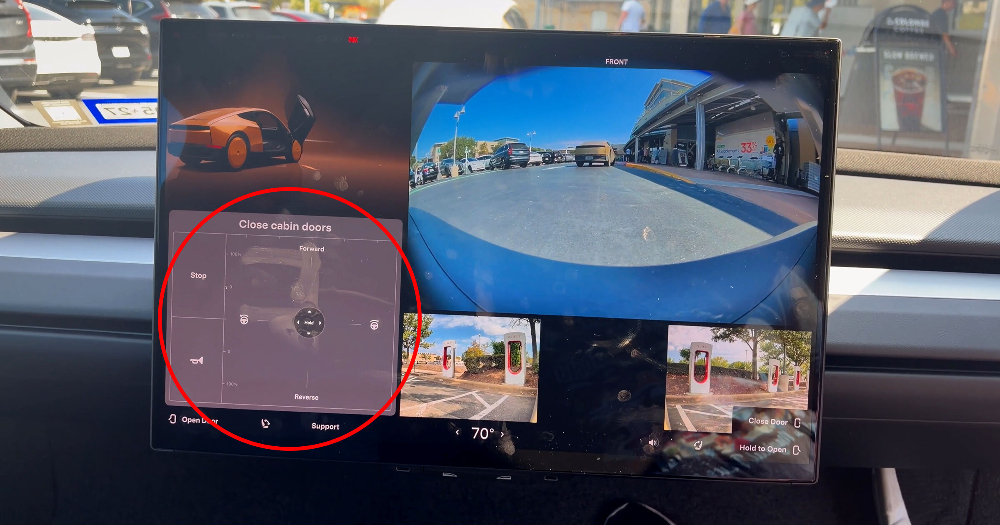

# 特斯拉Cybercab意外暴露隐藏手动驾驶虚拟操纵杆

> 特斯拉主打"不需要任何手动操作"的Robotaxi Cybercab，上周在奥斯汀上线后却被一名早期乘客意外发现：车机屏幕里藏着一套虚拟手动驾驶操纵杆——乘客能切挡、能开关车门，软件一抖动，所谓的无人驾驶就露了馅。

Cybercab车机屏幕意外显示的虚拟手动驾驶操纵杆界面

## 想藏却没藏住的"手动模式"

没有方向盘、没有踏板——这是特斯拉备受吹捧的Robotaxi Cybercab的最大卖点：一辆为自动驾驶而生的车，本不该需要任何人工操控。可上周在奥斯汀上线的头一批车里，一位名叫Matthew Skrzypczak的早期乘客却发现，这辆"无人驾驶"车其实还藏着手动驾驶的开关。

Skrzypczak在周末发帖说，他坐进Cybercab准备出发时，屏幕上没有出现供他下单开始行程的界面，取而代之的是一个"用于手动驾驶的虚拟操纵杆"。"我总觉得我不该看到这个,"他在X上写道。他上传的视频里，屏幕被分成多个画面，显示各路摄像头视角和若干车辆功能控制区；最关键的是，屏幕下方有一个可以换挡的触屏操纵杆，顶部写着"前进"、底部写着"倒车"。

## 能开门能按喇叭，就是开不走

Skrzypczak试着用这个操纵杆关上了车门、按响了喇叭——都成功了。可当他想真把车开动时，车却纹丝不动。这或许是件好事，因为附近就有行人。当然，也可能只是他根本没用对这个操纵杆。

这套功能几乎可以肯定是留给特斯拉员工和紧急救援用的——当车辆故障时需要有人把它挪开，手动操控显然很有必要。但问题是，为什么一个和Skrzypczak一样的普通乘客（还有另一位网友也撞见了同样的情况）能轻易调出这个界面。而即便是真要用，把手动控制藏在一块易滑的触屏后面，也远不如方向盘和踏板来得实用——至于为什么要做成这样，不过是让CEO马斯克能保住"无人驾驶"这块招牌。

## 缺了方向盘的合规争议

这个藏不住的"后门"也让监管者坐不住了。特斯拉在奥斯汀上线Cybercab后不久，美国国家公路交通安全管理局（NHTSA）就启动了审计，调查特斯拉在缺乏传统手动操控的情况下，是如何自我认证这些车辆可安全上路的。一台贴着"无人驾驶"标签的车，屏幕角落却晃着个能开走的操纵杆——对监管而言，这恰恰是最需要解释的地方。