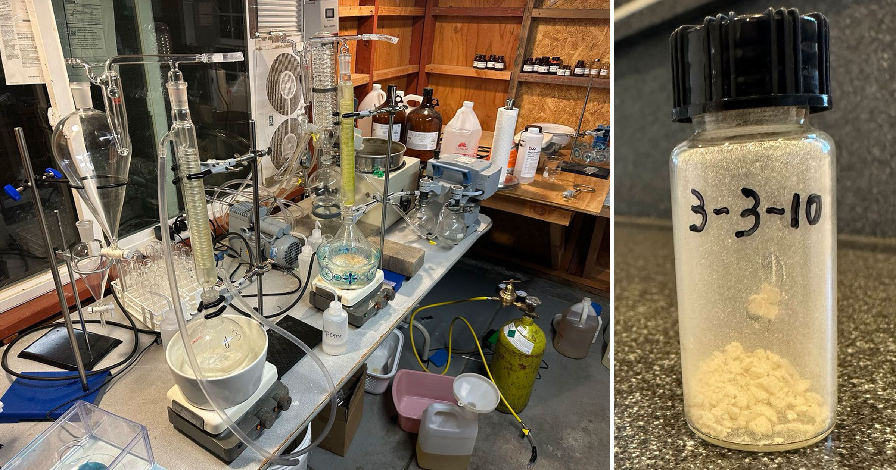

# 生化学家在车库用ChatGPT配方合成精神分裂症新药

> 年轻生化学家Douglas Yao在X上晒出自己用ChatGPT设计的配方、在车库搭的实验室里合成的一种精神分裂症新药"PAC-3310"，自称能用千分之一的成本颠覆药企的研发模式——评论区却一片嘲讽："相信你一个人在车库叠被桌上治好了精神分裂症，本身就是精神分裂症的典型症状。"

生化学家Douglas Yao展示用ChatGPT配方在车库实验室合成的黄色药粉样品

## 用ChatGPT开药方

在本周疯传X（原推特）的一条帖子里，年轻生化学家Douglas Yao展示了一款他借助ChatGPT开发的新药。他不在任何药企任职，所谓的药物实验室不过是车库里几张折叠桌拼出来的工作台。他反复强调自己研制的这种名为"PAC-3310"的药物用于治疗精神分裂症，"这是ChatGPT设计的，"他在帖子里说，"我在自己车库里搭的化学实验室里合成了它。"

帖中展示的是一小瓶黄色粉末，据称是3310的首个样品。Yao说这个分子以近期获批上市的抗精神病药Cobenfy为蓝本，"但做了改进"。

## 一年造出"数千种新药"

在GitHub主页上，Yao声称过去一年里用AI"设计了数千种全新的小分子药物",其中还包括一款"新的阿尔茨海默病药物"——这是他在精神分裂症疗法之外并行推进的项目。"我自学了合成化学，在车库里搭起化学实验室，亲手合成了其中一百种，"他写道，"目前正在细胞系和小鼠身上测试这些化合物。"

一个人包办的"制药实验室"究竟能走多远很难说。Yao援引行业惯例称，"药企开发一款新药，通常要投入数千万美元来积累临床前疗效证据"，而"我的方法只需千分之一的成本"。言下之意，他梦想有朝一日能大规模制造这些药物供人类服用——这个目标即便对一个资源充裕的正规药企，也要穷年累月、砸下重金，更何况是一个把电扇当排气通风橱的单干户。

## 从试验到上市的天堑

即便只看程序，新药要想走到美国药监局（FDA）面前，先要通过数轮临床前试验和三期临床试验，而新药申请（NDA）审查本身就要十二个月、还要查验生产厂房——这还只是"接近门槛"。先不说Yao口中的"数千万"，走完整个流程轻易就能烧掉几十亿美元。而且即便如此也远非稳赢：进入临床试验的药物，最终能拿到FDA完整批准的只有13.8%。

放到更大的尺度看，Yao若生在规则宽松的1970年代或许如鱼得水，但如今的现实是，监管严苛只是其一，低垂的果实早在几十年前就被摘光了。就以他的ChatGPT阿尔茨海默病药为例，2019年一项研究发现，自2003年以来没有一款阿尔茨海默病新药获批上市，倒不是没人试——超过200种候选物质要么在临床试验中折戟，要么被放弃。失败的坟场大到有机化学名家Derek Lowe专门开了个博客，定期为这些失败的神经退行性疾病药物写"验尸报告"。要说单靠ChatGPT就能跨过这些科学和体制上的深沟，只能说是痴人说梦。

## 病友式的嘲讽

评论区很快有人指出这其中的荒诞：用ChatGPT——一个以常把脆弱用户带向现实崩塌边缘而闻名的大模型——去合成治疗阿尔茨海默病、精神分裂症这类认知疾病的新药，本身就是莫大的反讽。"你好，精神分裂症患者，请服下这台ChatGPT给你开的药,"一名X网友打趣道。另一位则回敬："相信你一张商业叠被桌就独自治愈了精神分裂症——讽刺的是，这本身就是精神分裂症的经典症状。"