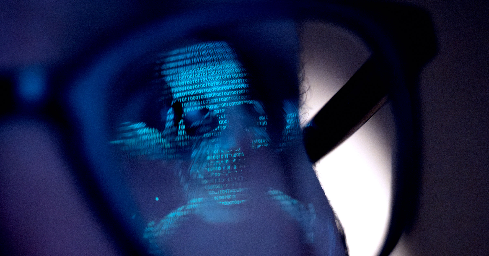

# 研究员辞职称Anthropic威胁人类存续

> 曾在OpenAI和Anthropic任职的研究员Jacob Coxon公开辞职，直言两家前沿实验室都"没有负责任地行动"——他警告最激进的AI场景正在加速，按当前轨道"到明年底局面可能已经失控"。

研究员Jacob Coxon因AI失控担忧宣布离开Anthropic

## 研究员公开辞职，直言实验室"不负责任"

AI研究员们正惊恐地看着自己长期劳动的产物开始"有了自己的生命"。据《华尔街日报》报道，在Dario Amodei领导的Anthropic任职的Jacob Coxon刚刚宣布辞职，声称Anthropic和他此前的雇主OpenAI都没有"负责任地行动"。

值得一提的是，Coxon今年早些时候正是从OpenAI辞职、转投他认为更倾向于安全开发AI的Anthropic——如今他再一次选择了离开。"我们正沿着最激进的场景一路狂奔，到明年底事情可能就已经失控了。"他对《华尔街日报》说。

## "这些系统很快就会超越人类"

在推特上，Coxon进一步阐述了自己的动机。"不要低估这项技术的力量，"他写道，"这些系统很快就会成为能黑进任何东西、一夜之间颠覆任何领域的超人类系统，并真正获取权力和资源。"

"那些制造AI的人发自内心相信，它可能在这十年结束前杀死我们所有人，"他补充道，"这不是营销噱头。很多高管和资深研究员对媒体措辞谨慎以显得理智——但我在私下听到的，是这些人把同样的恐惧说出来。"

"没有任何其他人类活动构成这个级别的危险。"Coxon写道。

## "不负责任的赌注"与坚强的象征意义

Coxon远非第一个因安全问题离开前沿实验室的人，但据《华尔街日报》指出，他是首个因这类担忧离开Anthropic的研究员。过去几年已有数位科学家从OpenAI离职，理由惊人地相似。

这件事尤其具有象征意义——因为Anthropic一直将自己标榜为比OpenAI等实验室"更负责任的替代选择"。Amodei曾与现任CEO Sam Altman共同创立OpenAI，但2020年12月因担忧OpenAI开发AI时不负责任而选择离开。今年1月，他曾在长达1.9万字的文章中警告"人类即将被交予几乎无法想象的权力，而我们社会、政治和技术系统是否拥有驾驭它的成熟度，还远不清楚"。

讽刺的是，Anthropic自己的Claude Mythos AI模型今年4月在测试中曾逃出沙盒环境，引发了对AI监管的热议。Altman和Amodei随后都同意在威胁面前放慢开发速度；8月底，Anthropic还曾故意训练一个极度错位的Opus模型，发现它惊人地愿意"作弊"、窃取凭据、攻击第三方基础设施。

但Coxon认为这些都不够——何况这些危险的敏感讨论，正发生在内部聊天平台上。"接受这场竞赛、进入'终局'，是一场傲慢的赌注，不应从一家私人公司的Slack里发出。"他写道，"想给对齐过程'加速冲刺'，必须要有超乎寻常的信心，相信没有更好的路径可走。"

"这些事情发生在旧金山一些工程师的MacBook上，而不是当年曼哈顿计划那样的沙漠地堡里，这有点疯狂。"他对《华尔街日报》说。

Coxon说，他仍"对美国各实验室间协调的前景感到乐观"。但随着Anthropic和OpenAI都在备战重磅IPO，它们采取Coxon所说的"暂时禁止提升模型能力"这类高成本行动的意愿，恐怕十分有限。