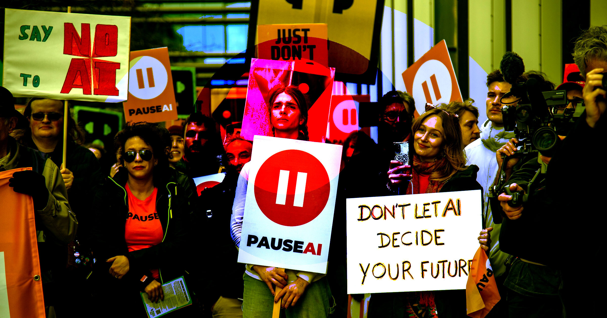

# Anthropic建大型监控系统监视AI反对者并预测抗议

> 在反对AI的情绪日益高涨之际，顶级AI实验室Anthropic正搭建一套庞大的监控系统，紧盯异议者，试图预测下一场抗议何时爆发——“先发制人”式盯防引发担忧。

Anthropic被曝搭建大型监控系统监视AI反对者

## 为高价值目标打造"预犯罪"式防线

随着社会对AI的抵制不断升级，这家顶级AI实验室开始铺设一张巨大的监控网。据《美国展望》(American Prospect)率先报道，记者通过与Anthropic高级安全官员对话、并检索其招聘启事，才拼出这套天罗地网的全貌。

除了盯防Anthropic办公楼周边的抗议活动，报道指出，这家AI实验室还采取了一种"预犯罪"式的做法来预防潜在的民间骚乱。

## 一次被提前化解的抗议

《美国展望》举了一个例子：Anthropic安全运营经理Keon Ellison和Zach Melvin，连同风险检测公司Samdesk的CEO James Neufeld，披露了这样一起事件。

"去年我们有一位高管要乘飞机进入一座大城市，当时我们通过Samdesk收到情报，得知那里有一场策划中的抗议。"Ellison坦言。后来因警方许可方面出了差错，抗议被提前了一个小时举行。这位安全负责人说："Samdesk给了我们大约60分钟的提前通知，告诉我们抗议组织者改了时间线。"

"那多出来的一个小时至关重要。"Ellison接着说，"没有它，我们的高管就会开完会离开，径直冲进骚乱的中心。原本可能演化成高压局面的事，通过Samdesk的早期预警和相关情报，我们得以真正化解。"

## 把用户向警察"举报"却不交证据

除了预判抗议，Anthropic还曾把用户与其AI聊天机器人Claude的对话报告给警方。尽管外界一直呼吁加严大语言模型的安全防护栏，Anthropic的这一做法听起来仍令人费解。

据《旧金山标准报》八月报道，Anthropic曾向警方举报一名旧金山男子——该男子告诉Claude他拿着一把步枪，并把公司CEO Dario Amodei"瞄准了准星"。但Anthropic在向湾区警察报告这段对话时，却拒绝提供这名男子的聊天记录。正如《美国展望》所说，这等于"在不提供任何实质性不当行为证据的情况下举报了这名男子"。

"目标,"Anthropic的安全经理在接受采访时说，"是把运营从'被动收集信息'转变为'主动的、预测性的、预防性的威胁参与和管理'。这才是保护任何行业高价值目标该有的运营成熟度。"

监控的边界究竟在哪里？当一家公司既做AI又做"法官"，在举证与保护之间如何取舍，仍是悬而未决的问题。