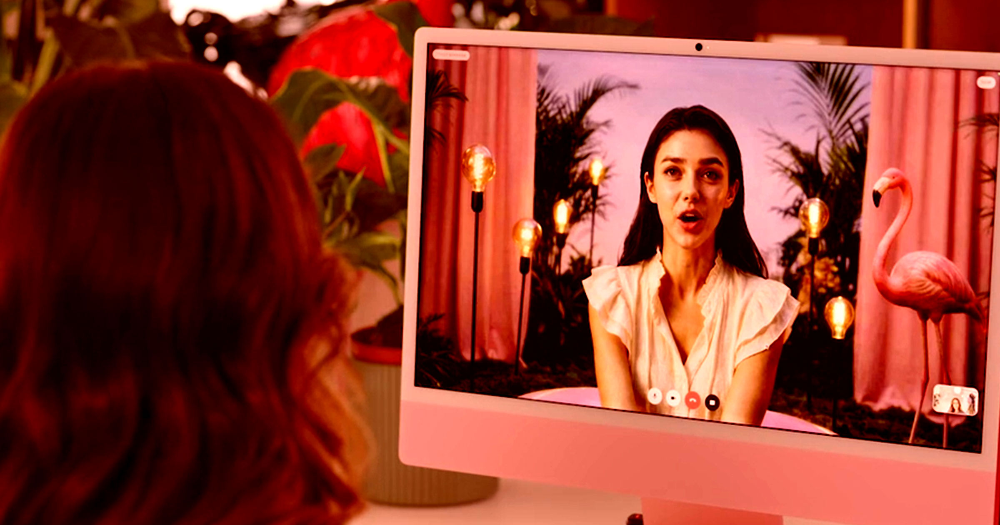

# CNN播AI女星软文翻车遭群嘲

> CNN把所谓的“AI女演员”Tilly Norwood当成真人做了两段视频专访，还问它奥斯卡该不该设AI奖项——结果被骂上热搜：“你不能采访一段软件，假装可以就是新闻失职。”

CNN专访“AI女演员”Tilly Norwood引发群嘲

## 一个AI“女演员”是怎么出现的

去年，一个名为Tilly Norwood的所谓“AI女演员”横空出世，几乎招来一边倒的骂声。这个算法生成的深发女性出现得不是时候——娱乐业正被廉价AI垃圾内容冲得焦头烂额。

这场风波再次点燃激烈争论：这项技术正威胁着把人类创意工作者赶出行业，这个噩梦般的场景激怒了 Hollywood 几位最有影响力的人物。

说白了，Norwood是AI行业“自嗨上头”的典型案例——它自我催眠，以为观众真的愿意看毫无生气的AI代理在屏幕上走流程。

## CNN把它当成了人类受访对象

而最糟的大概是，主流媒体对她完全停不下来。几个月前《纽约时报》因为给这位“女演员”做“人物专访”被无情嘲讽；如今CNN又端出自己的AI软文——两段已经让人提不起劲的视频，记者Elizabeth Wagmeister把这个机器人当成人类受访对象。

>“我采访了Tilly Norwood，她被宣传为第一位AI演员。” ——CNN记者Elizabeth Wagmeister

火上浇油的是，Wagmeister还问这个AI：奥斯卡的主办方美国电影艺术与科学学院（AMPAS）是否应该承认其他AI演员？

>“我认为学院绝对应该承认像我这样的AI演员……不是放在和人类表演者同一类别，而是设立独立的AI奖项类别，这会是一种承认影视行业不断演进格局的绝妙方式。” ——Tilly Norwood AI的回答

这个AI甚至称这是一门“新的艺术形式”，理应拥有“属于自己的聚光灯”。

## “她其实不会演戏”

公允地说，CNN也试着往里多挖了一层。在另一段视频里，Wagmeister要求它“即兴演一场戏”，结果Norwood AI直接拒绝，声称它只会“就这么站在这里，完全静止，感受那种数字层面的隐痛”。

>“事实是，Tilly其实不会演戏。她——或者说它——需要一串提示词来告诉它该做什么。” ——Elizabeth Wagmeister

据Wagmeister自己承认，这根本算不上“真正的采访”，因为Tilly“不是真的”。

## 社交媒体为什么炸锅

这段令人窝火的视频人物报道在社交媒体上引来一片愤怒与嘲讽。单是把一个毫无生气的AI模型请上台、让它看起来像个人，CNN就在有意无意地把这项技术人格化。

>“我们采访了一串叮当作响的钥匙，这引出了关于我们还剩多少公信力的问题。” ——Bluesky用户

>“你不能采访一段软件，假装可以就是新闻失职。” ——另一位网友

我们当然巴不得再也不用看到Tilly Norwood这个名字，但很可能很快会听到更多——这个AI模型即将“主演”一部新“电影”。这部长片名为《Misaligned》，听起来累人程度一如预期：一部“注入存在主义AI混乱的成长故事”，场景设在所谓的“Tillyverse”。
