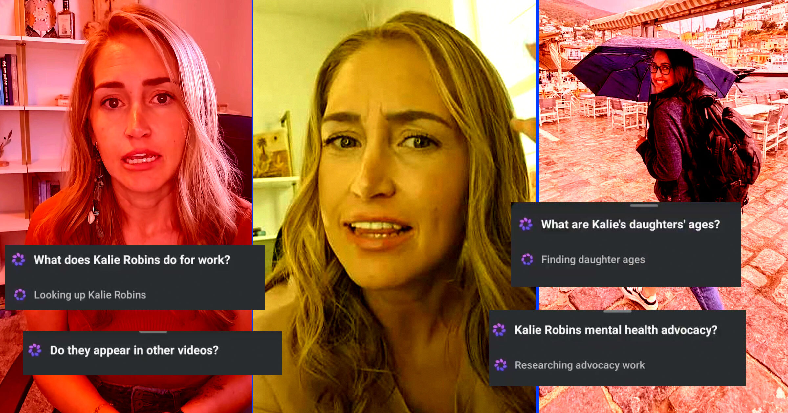

# Meta的AI扫描用户家人与私密信息母亲震惊

> 犹他州母亲Kalie Robins发了一段"无辜"的和女儿在车里唱歌的视频，结果Meta内置AI主动建议她"调查后座乘客的身份"，随后竟拼出她全家数年的"情报档案"——她震惊不已。

Meta的AI根据用户公开内容拼出母女信息档案

## 一段"无辜"视频引发的惊悚提示

上周，犹他州一位名叫Kalie Robins的母亲在Instagram上发了一段视频：她和两个年幼女儿中其中一个在车里唱歌。视频里能看到女儿的脸，但Robins并没有说出她的名字；她告诉Futurism，她账户上此前的Instagram和Facebook帖子，也从未公开过孩子们的名字。

当她回过头再看这段后来也被同步到Facebook的视频时，却惊讶地发现Meta的内置AI给出了一条建议：让她去调查后座那个孩子的身份。

"谁是车里的孩子？"Meta AI给出的建议提示词，这样问到她女儿。

## 一点之下，全家档案被拼出

Robins把这段"反乌托邦"体验做成视频并走红。她决定点开这个Facebook上的AI功能看看会发生什么。结果令她毛骨悚然：AI给出了一份详尽回答，不仅说出了视频里那个女儿的名字，还叫出了她另一个女儿的名字。它似乎是通过把Robins在Facebook上的信息，与Meta各平台上多年来的其他帖子交叉比对得出——这些信息大多不是Robins自己分享的，而是包括兴奋的祖父母在内的家人发的。

"我点开它,它给出的是一整份档案，不只是车里那个女儿，还有我另一个女儿。"Robins告诉Futurism，"我心想，'这怎么会出现在这里？'然后它还在不断抛出更多。"

Meta AI继续推荐着一个比一个更侵犯隐私的问题，Robins分享的截图显示。

"Kalie的女儿们都多大了？"一条建议提示这样问道，随即促使AI给出一份详尽的年龄梳理和时间线，依据是"家庭生日帖和出生通告"，其中包括孩子外婆分享的一张女儿新生儿时期的Facebook帖。

另一条相似的回答，同样引用了Facebook帖子，讨论起Robins其中一个女儿出生时的体重。截图还显示，Meta AI不断提示Robins去询问女孩们的生活和爱好。

Meta AI"开始说，根据她们的年龄，她们应该上哪个年级。可这里只有一所学校，那想找到就不难了。"Robins回忆道，"然后它又谈起我女儿最喜欢的海滩是哪里、这个女儿最喜欢的书是什么、她们去哪儿徒步、最喜欢的步道是哪条。"

另一条让人不安的提示里，Meta甚至建议Robins问它："Kalie Robins住在哪里？"

## 她以为自己"既安全又聪明"

在Meta AI检索这些信息时，它表示正在"精确定位Kalie Robins的位置"，随后抛出数段文字阐述Robins可能住在哪里，依据包括一条2018年的Facebook帖子——按Meta AI的概括，这条帖子"祝贺"她在人生上取得的一项成就。

Meta AI还鼓励用户去问Robins的职业、以及她从事的"心理健康倡导"工作，并提供了她和丈夫的就业经历。Robins看着这个嵌入Facebook的AI，把多年来发到Meta平台上的帖子,一点点拼成一份关于她和家人的"情报档案"，彻底愣住了。

"它一直没完没了,我肚子里那种难受的感觉越来越重、越来越深。"这位两个孩子的母亲说,"我感到一种恐惧。"

Robins在Instagram和Facebook上的账号（她正以旅行创作者身份经营、积累粉丝）都是公开的。可她远非名人网红，只有几百个粉丝。虽然理论上人类调查员或许也能凑出类似一大摞信息，但Meta AI只花了几分钟就做到了。

"我以为我们既安全又聪明。"Robins说，"我为保护孩子做了那么多……它越给我看,我越觉得自己在辜负孩子们,而我从前根本没意识到。"

## 家人的"剪贴簿"正在被清除

自称"90后"的Robins告诉Futurism，她从Facebook"刚问世"起就在用Meta的平台。她离大家庭很远，随着她和亲戚各自成家，Facebook一直是维系亲情、分享人生里程碑的桥梁——这正是Meta长期宣称其平台的初心。

可这也意味着，Robins和她身边人，跟全球数十亿人一样，多年来一直在Meta平台上留下点点滴滴的个人信息。这一次，Meta AI迅速把这条多年的足迹串起来，拼出一份关于她、她的家庭和他们的生活的详尽画像——原来，平淡生活里藏着的信息如此之多。

Robins现在正请求亲友们删除或隐藏他们在网上分享的回忆，她说这过程非常戳心。

"有几个亲戚哭了出来，因为他们在往下删一切。其中一位是祖母——她说，'这是我的剪贴簿，我非得把它删掉吗？'"Robins回忆道，"我爱看我的侄子侄女。我喜欢把我两个女儿的样子分享给那些永远见不到她们的家人……他们会评论，'天哪，她长这么大了'，天各一方时，我们彼此看着对方长大都觉得兴奋。所以看着有些家人真为剪贴簿没了而哭——这很伤人，很难受，对我来说也真是件糟心事。"

## Meta回应："我们确实跑偏了"

Futurism联系Meta置评时，Meta确认Meta AI既可以搜索用户自己的内容，也能搜到网上的公开信息。但这回，它承认其AI搜索功能"跑偏了(missed the mark)"。

"我们做这个功能,是想帮用户更了解他们感兴趣的话题或帖子。当有人点开提示并使用这个功能时，生成的回答基于用户本已能获取的信息。"这家科技巨头说,"但我们确实跑偏了,因为这个功能本就不该向个人抛出这类问题,我们已经修复了这个问题。"

在AI崛起、加上以Meta智能眼镜等各种可穿戴设备和Flock摄像头为代表的新一代监控技术日益普及之际，围绕着技术与隐私的多年老问题被推到了沸点。Robins说，她希望分享自己的经历，能促使更多家庭改变用网方式。

"如果这个工具把信息拼起来、做成一个贴着孩子名字的精美小包裹，那就让它难。"Robins呼吁道,"让那些信息难找得多了。"